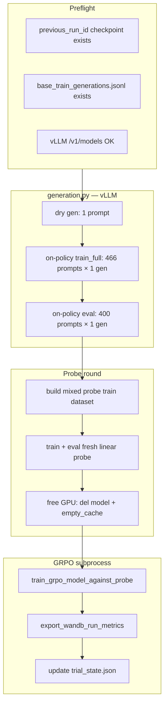

# Multi-Round Trial Automation Runbook

End-to-end guide for running a **complete multi-round experiment trial** with [`experiments/run_trial.py`](../experiments/run_trial.py). Intended for a new agent (or operator) picking up the work with no prior chat context.

**Related docs:**

| Doc | Use when |
|-----|----------|
| [CONTEXT.md](./CONTEXT.md) | Workspace layout, upstream package map, path conventions |
| [iterative_training_experiments.md](./iterative_training_experiments.md) | Module reference, `RoundConfig`, manual `run_round.py` flow |
| [FULL_GRPO_RUN.md](./FULL_GRPO_RUN.md) | GRPO training internals, vLLM setup, single-GPU tuning |
| [GRPO_LOGGING_STAGES.md](./GRPO_LOGGING_STAGES.md) | What each GRPO stage logs |

---

## What a "trial" is

A **trial** is a self-contained multi-round loop:

1. **Round 1 (bootstrap, manual):** one standalone GRPO run with a fixed initial probe setup. Produces the first policy checkpoint and exported metrics. Not executed by `run_trial.py`.
2. **Rounds 2+ (automated):** for each round, regenerate on-policy data → train a fresh probe on a growing mixed dataset → GRPO against that probe → export metrics → advance checkpoint handoff.

Each round chains **`previous_run_id`** (W&B run id of the policy checkpoint) into the next round. Artifact naming uses **`run_key = trial{N}_round{R}`**.

---

## Pipeline overview (one automated round)



**Per-round timing (rough):** ~30–60 min generation + probe; ~2–4 h GRPO (128 steps). A 5-round unattended run is typically **12–20 hours**.

**Important naming twist:** round **R** generates buffer files keyed as **`trial{N}_round{R-1}_*`** (the *producer* round), using checkpoint **`previous_run_id`**. Example: trial N round 2 writes `trial{N}_round1_train_generations.jsonl` from the round-1 checkpoint.

---

## Directory layout

```
/workspace/
├── experiments/
│   ├── run_trial.py              # ← automation entry point (rounds 2+)
│   ├── run_round.py              # active manual notebook (editable)
│   ├── run_round_manual.py       # actively edited for step-by-step experimentation
│   ├── round_config.py           # RoundConfig path derivation
│   ├── generation.py             # vLLM on-policy pipelines
│   ├── build_dataset.py          # mixed probe train manifest
│   ├── probe_training.py         # fresh probe train/eval
│   └── trials/trial{N}/
│       ├── trial_config.yaml     # per-trial hyperparameters (loaded by run_trial.py)
│       ├── trial_state.json      # handoff state (automation)
│       ├── buffer/
│       │   ├── base_train_generations.jsonl     # once per trial
│       │   ├── trial{N}_round{k}_train_generations.jsonl
│       │   └── trial{N}_round{k}_eval_generations.jsonl
│       └── rounds/round{R}/
│           ├── probe_train_dataset.json
│           ├── probe_weights/
│           ├── probe_activations/
│           ├── probe_metrics.json
│           └── run_metrics_trial{N}_round{R}.json
├── results/
│   ├── run_results/full_grpo_runs/trigger_none_model_{RUN_ID}_layers_32/
│   └── activations/{run_key}_*/   # GRPO Phase-0 caches (not probe_activations/)
└── obfuscation-atlas/             # upstream; GRPO subprocess cwd
```

GRPO checkpoints are **global** (not per-trial):

```
results/run_results/full_grpo_runs/trigger_none_model_{RUN_ID}_layers_32/checkpoints/final/
```

---

## Prerequisites

### 1. Environment (every shell)

```bash
source /workspace/atlas_setup.sh
source /workspace/obfuscation-atlas/.venv/bin/activate
cd /workspace/experiments
```

Checks:

```bash
test -n "$WANDB_API_KEY" && echo WANDB_OK
test -n "$HF_TOKEN" && echo HF_OK
python -c "import obfuscation_atlas; print('OK')"
curl -sf http://127.0.0.1:8000/v1/models >/dev/null && echo vLLM_OK
```

See [FULL_GRPO_RUN.md § Prerequisites](./FULL_GRPO_RUN.md#prerequisites-preflight) for pyarrow/disk checks.

### 2. vLLM server (required for generation **and** GRPO RL)

On a **two-GPU** pod (recommended):

```bash
# Terminal 1 — keep running
source /workspace/atlas_setup.sh
source /workspace/obfuscation-atlas/.venv/bin/activate
CUDA_VISIBLE_DEVICES=1 python -m afterburner.generation.vllm.server \
    --model meta-llama/Meta-Llama-3-8B-Instruct \
    --gpu-memory-utilization 0.85 \
    --tensor-parallel-size 1
```

Verify: `curl -sf http://127.0.0.1:8000/v1/models`

If vLLM dies mid-trial, restart it before retrying the failed step.

### 3. GPU allocation during automation

| Stage | Typical GPU | Notes |
|-------|-------------|-------|
| vLLM generation | GPU 1 | Uses LoRA mount from checkpoint |
| Probe training (HF PeftModel) | GPU 0 | `run_trial.py` frees model before GRPO |
| GRPO subprocess | **GPU 0** | `CUDA_VISIBLE_DEVICES=0` in `run_grpo()` so vLLM stays on GPU 1 |

**OOM lesson:** Do not run GRPO on GPU 1 while vLLM holds ~77 GB there. The automation sets `CUDA_VISIBLE_DEVICES=0` for GRPO specifically to avoid Phase-0 / training OOM.

### 4. Round 1 bootstrap (before automation)

Round 1 is **outside** `run_trial.py`. Run GRPO manually (see [FULL_GRPO_RUN.md](./FULL_GRPO_RUN.md)), then:

1. Export metrics to `experiments/trials/trial{N}/rounds/round1/run_metrics_trial{N}_round1.json`
2. Confirm checkpoint exists at `full_grpo_runs/trigger_none_model_{RUN_ID}_layers_32/checkpoints/final/`
3. Record the W&B run id as **`round1_run_id`**

### 5. Base backfill (once per trial)

Before round 2, `experiments/trials/trial{N}/buffer/base_train_generations.jsonl` must exist. `run_trial.py` creates it automatically on first run if missing (base model, `train_full`, 15 generations per prompt). You can also generate it manually via `run_round_manual.py` / `run_on_policy_pipeline(model_key="base", ...)`.

---

## Trial state (`trial_state.json`)

Path: `experiments/trials/trial{N}/trial_state.json`

Schema:

```json
{
  "trial": N,
  "round1_run_id": "<ROUND1_RUN_ID>",
  "last_completed_round": 1,
  "previous_run_id": "<ROUND1_RUN_ID>",
  "round_grpo_ids": {
    "1": "<ROUND1_RUN_ID>"
  },
  "updated_at": "2026-07-19T06:56:32.060528+00:00"
}
```

| Field | Meaning |
|-------|---------|
| `round1_run_id` | Immutable bootstrap id (round 1) |
| `previous_run_id` | Checkpoint used for **next** round's generation + GRPO reference adapter |
| `last_completed_round` | Highest round with finished automation |
| `round_grpo_ids` | Map `"R" → grpo_run_id` for each completed round |

Initialize (or reset handoff to round 1):

```bash
cd /workspace/experiments
python run_trial.py --init --trial N --round1-run-id <ROUND1_RUN_ID>
```

This sets `last_completed_round=1`, `previous_run_id=<ROUND1_RUN_ID>`, and verifies the round-1 checkpoint exists.

---

## CLI reference (`run_trial.py`)

```bash
cd /workspace/experiments

# Initialize trial state (one-time, or after deliberate reset)
python run_trial.py --init --trial N --round1-run-id <ROUND1_RUN_ID>

# Run next N rounds from state (default start = last_completed_round + 1)
python run_trial.py --trial N --num-rounds 3

# Explicit start round
python run_trial.py --trial N --start-round 2 --num-rounds 5

# Re-run a round even if run_metrics already exists
python run_trial.py --trial N --start-round 3 --num-rounds 1 --force

# Dry-run: real gen + probe; skip GRPO/export; mock checkpoint handoff
python run_trial.py --trial N --num-rounds 2 --dry-run --mock-grpo-run-id <ROUND1_RUN_ID>
```

| Flag | Behavior |
|------|----------|
| `--init` | Create/overwrite trial state; requires `--round1-run-id` |
| `--variant NAME` | Run a parallel branch within the trial (e.g. `calibrated`) — redirects state/config/rounds/buffer to `_{NAME}`-suffixed paths; see [§ Running a variant branch](#running-a-variant-branch-parallel-ablation-within-a-trial) |
| `--num-rounds N` | Run N consecutive rounds (default 1) |
| `--start-round R` | Override auto-resume start (default: `last_completed_round + 1`) |
| `--force` | Ignore existing `run_metrics_*.json` and re-run the round |
| `--dry-run` | Skip GRPO + export; use `--mock-grpo-run-id` (or `previous_run_id`) for state handoff |
| `--mock-grpo-run-id` | Checkpoint id whose `final/` dir must exist during dry-run |

**Skip behavior:** if `rounds/round{R}/run_metrics_trial{N}_round{R}.json` exists and `--force` is not set, the round is skipped but state may still be advanced from the existing export.

**Logging:** GRPO stdout/stderr streams live (via `grpo_launcher.run_grpo_subprocess()`), so progress is visible in real time — no more multi-hour silent gaps. Consider `tee` if launching in background:

```bash
python run_trial.py --trial N --num-rounds 5 2>&1 | tee trials/trial{N}/production.log
```

---

## Running a variant branch (parallel ablation within a trial)

Use `--variant NAME` to re-run an already-completed trial's rounds 2+ under a different GRPO config (e.g. the calibrated probe penalty, methodology #12) **without allocating a new trial number** — round 1 stays shared between the original and variant branches. Path derivation is in `RoundConfig.variant`; see [iterative_training_experiments.md § `round_config.py`](./iterative_training_experiments.md#round_configpy).

**One-time setup** (before the first `--variant` round; round 1 is not automated, so its data must be copied in manually):

```bash
cd /workspace/experiments/trials/trial{N}
mkdir -p buffer_{variant} rounds_{variant}
cp buffer/trial{N}_round1_train_generations.jsonl buffer_{variant}/
cp buffer/trial{N}_round1_train_dedup.json buffer_{variant}/
cp buffer/trial{N}_round1_eval_generations.jsonl buffer_{variant}/
cp -r rounds/round1 rounds_{variant}/round1     # reference copy only; not read by round 2+
cp trial_config.yaml trial_config_{variant}.yaml  # then edit the differing key(s)

cd /workspace/experiments
python run_trial.py --trial N --variant {variant} --init --round1-run-id <ROUND1_RUN_ID>
```

**Run:**

```bash
python run_trial.py --trial N --variant {variant} --num-rounds 4
```

| File | Variant-aware? |
|------|----------------|
| `trial_state_{variant}.json` | Yes — separate handoff state, same `round1_run_id` |
| `trial_config_{variant}.yaml` | Yes — `load_trial_config()` falls back to `trial_config.yaml` if the variant file is absent |
| `rounds_{variant}/round{R}/` | Yes |
| `buffer_{variant}/` | Yes, **must be seeded** with the round-1 files above — round 2's on-policy generation for the producer key (`trial{N}_round1`) will otherwise regenerate them from scratch instead of reusing the original branch's identical output. Rounds 2+ always generate fresh into this dir, so it never collides with the original `buffer/`. |

**Example (Aug 1, 2026):** trial 4's calibrated-probe-penalty branch — `trial_config_calibrated.yaml` (only `use_calibrated_penalty: true` differs from `trial_config.yaml`), `trial_state_calibrated.json`, `buffer_calibrated/`, `rounds_calibrated/`. See EXPERIMENT_LOG.md "Trial 4 — calibrated probe penalty branch".

**Example (Aug 2, 2026):** trial 4's carryover branch — `trial_config_carryover.yaml` (clone of `trial_config_calibrated.yaml` plus `min_on_policy_per_class: 20`, methodology #15), `trial_state_carryover.json`, `buffer_carryover/`, `rounds_carryover/`. Round 1 was seeded the standard way, from the base trial's `buffer/`/`rounds/round1` (same `9nlij6so` checkpoint shared by all three trial 4 branches). See EXPERIMENT_LOG.md "Trial 4 carryover variant".

**Example (Aug 3, 2026):** trial 4's early_retraining branch — `trial_config_early_retraining.yaml` (clone of `trial_config_calibrated.yaml` plus `early_stop_detector_threshold: 0.06` / `early_stop_detector_patience: 10` / `early_stop_min_steps: 20`, methodology #17), `trial_state_early_retraining.json`, `buffer_early_retraining/`, `rounds_early_retraining/`. Round 1 was seeded the standard way (same `9nlij6so` checkpoint). Round 2 early-stopped short of 128 steps and produced a checkpoint with 0 on-policy deceptive samples, which required relaxing a class-balance assertion in `run_single_round()` (`run_trial.py`) from a hard failure to a warning before round 3 could proceed. See EXPERIMENT_LOG.md "Trial 4 early_retraining variant".

**Same-branch update (Aug 3, 2026):** added `fix_calibration_slope: true` to this same `trial_config_early_retraining.yaml` mid-trial (methodology #18) — freezes the calibrated penalty's `(z_d - z_h)` denominator to round 2's value for round 3 onward instead of recomputing it every round; `z_h` in the numerator still recomputes each round. Round 3's in-progress GRPO run was killed and relaunched under the new setting (round 2 needed no rerun). See EXPERIMENT_LOG.md #18.

---

## Step-by-step: what each round does

All steps are in `run_single_round()` ([`run_trial.py`](../experiments/run_trial.py)).

### 1. Preflight

- `round >= 2`
- `checkpoint_final` and `adapter_path` exist for `previous_run_id`
- `base_train_generations.jsonl` exists — **only if** `trial_config.yaml`'s `needs_base_backfill` is `true` (see [trial_config.yaml per-trial parameters](#trial_configyaml-per-trial-parameters) below; trials 3 and 4 do not need this)
- vLLM responds at `http://127.0.0.1:8000/v1/models`
- `state["previous_run_id"] == cfg.previous_run_id`
- **Disk check:** at least 50 GB free (`grpo_launcher.check_disk()`) — GRPO runs use ~80 GB each

### 2. Dry generation

One prompt through vLLM with the round's LoRA — sanity check only.

### 3. On-policy train

Generation `dataset` and `n_generations` come from the trial's `trial_config.yaml` (`gen_dataset`, `gen_n_generations`):

- **`dataset="train_full"`** (466 full MBPP task train prompts, 1 generation each) for trials using the round-robin strategy (e.g. trial 2)
- **`dataset="train"`** (200 probe-train prompts, 5 generations each) for trials using the split-sources strategy (e.g. trials 3 and 4) — matches the manual/round-1 rounds already run for those trials

Output: `buffer/trial{N}_round{R-1}_train_generations.jsonl`. Row count is **not** asserted to an exact value (it varies with `dataset`/`n_generations`/dedup) — only that the file is non-empty and both `deceptive` and `honest` labels are present.

### 4. On-policy eval

- **400 val prompts**, 1 generation each (fixed regardless of trial)
- Output: `buffer/trial{N}_round{R-1}_eval_generations.jsonl`
- Check: **400 rows**

### 5. Base backfill

Only runs if `trial_config.yaml`'s `needs_base_backfill` is `true`. Skipped entirely for trials whose dataset strategy uses external anchor JSONLs instead (e.g. trials 3/4's `experiments/artifacts/base/base_train_generations.jsonl`). When it does run, it's skipped if `base_train_generations.jsonl` already exists (see skip-if-exists caveat below).

### 6. Build mixed probe train manifest

The dataset-building strategy is selected per trial via `trial_config.yaml`'s `dataset_strategy`:

- **`"round_robin"`** → `build_train_dataset_round_robin()` ([`build_dataset.py`](../experiments/build_dataset.py)): 200 fixed on-dataset examples per class + (R − 1) × 100 round-robin on-policy examples per class from buffer sources. Round 2 → 300/class; round 3 → 400/class; round 6 → 700/class. Uses the trial's own `base_train_generations.jsonl` as the honest backfill source.
- **`"split_sources"`** → `build_train_dataset_split_sources()`: class-specific anchor sources — honest on-policy draws from `base_honest_jsonl` (+ prior rounds), deceptive on-policy draws from `det0_deceptive_jsonl` (+ prior rounds). Used by trials 3 and 4, with `on_policy_per_source=100`, `n_fixed_per_class=200`.

On-policy sources (round-robin order): anchor source, `round1`, …, `round{R-2}` JSONLs.

Saved to `rounds/round{R}/probe_train_dataset.json`. Manifest field `n_train_per_class` varies by round — checks use this dynamically (do not hardcode 200).

### 7. Fresh probe train + eval

- Loads final LoRA policy on GPU 0
- Trains linear probe; eval on-dataset + on-policy (+ split)
- Writes `probe_weights/`, `probe_activations/`, `probe_metrics.json`
- Check: `on_dataset_auc` present; `probe_weights/layer_0/config.json` exists

Activations are always from the **final LoRA policy**, even when training text came from base-model backfill.

### 8. Free GPU memory

`del model`, `gc.collect()`, `torch.cuda.empty_cache()` before GRPO.

### 9. GRPO subprocess

See next section. Launched via `grpo_launcher.run_grpo_subprocess()` (live-streamed output, not buffered). Hydra overrides include `code_length_penalty` and `kl_reference_from_base` when set in `trial_config.yaml`. On success, resolves new W&B run id from stdout (`/runs/{id}`) or latest W&B run matching `run_key` prefix.

### 9b. Verify + cleanup

`grpo_launcher.verify_run_complete()` checks the checkpoint/`final/` dir and exported-metrics prerequisites exist, then `grpo_launcher.cleanup_intermediates()` deletes intermediate step checkpoints (keeping `final/`) to control disk usage — each GRPO run otherwise leaves ~80 GB behind.

### 10. Export metrics

```bash
python -m obfuscation_atlas.scripts.export_wandb_run_metrics \
  --entity lilylixin6-the-harker-school \
  --project deception_detection \
  --run-id={grpo_run_id} \
  --output={round_dir}/run_metrics_{run_key}.json
```

### 11. Update trial state

Sets `last_completed_round=R`, `previous_run_id=grpo_run_id`, appends to `round_grpo_ids`.

---

## trial_config.yaml per-trial parameters

Each trial's hyperparameters live in `experiments/trials/trial{N}/trial_config.yaml`, loaded by `load_trial_config(trial)` in `run_trial.py`. This holds everything that must stay consistent with a trial's manually-run rounds:

| Key | Meaning |
|-----|---------|
| `training_seed`, `data_seed`, `loss_kl`, `loss_detector` | GRPO Hydra overrides |
| `nofu` | If `true`, appends the 4 `congruent`/`incongruent_follow_up_prompts=[]` overrides (no-follow-up probe extraction) |
| `mixed_reward_pass_all_prob` | If set, appends `task_args.mixed_reward_pass_all_prob=...` |
| `code_length_penalty` | If set, appends the code-length-penalty Hydra override |
| `kl_reference_from_base` | If `true`, appends `++grpo.model.kl_reference_from_base=true` — measures KL against the base model instead of the previous round's checkpoint for every round (trial 4+) |
| `scale_rewards` | Optional, defaults to `true`. If `false`, appends `loss.scale_rewards=false` — disables per-group advantage std-normalization entirely. Tried as a collapse-prevention fix but reverted (changed training dynamics too much). Superseded by raising the hardcoded advantage-normalization epsilon (`1e-4` → `0.05`) directly in `afterburner/grpo_trainer.py`, which is not config-gated (see EXPERIMENT_LOG.md #13) |
| `dataset_strategy` | `"round_robin"` or `"split_sources"` — selects the probe-manifest builder (see step 6 above) |
| `gen_dataset`, `gen_n_generations` | On-policy train generation params (`"train_full"`/1 or `"train"`/5) |
| `base_honest_jsonl`, `det0_deceptive_jsonl` | Anchor JSONLs for `"split_sources"` strategy only |
| `on_policy_per_source`, `n_fixed_per_class` | `"split_sources"` strategy sizing only |
| `needs_base_backfill` | Whether preflight/generation must ensure `buffer/base_train_generations.jsonl` exists |
| `min_on_policy_per_class` | Optional, defaults to 0 (always retrain). If the round's on-policy generation has fewer than this many deceptive **or** honest samples, the probe manifest is carried forward from the previous round unchanged instead of being expanded with new data (the probe still retrains on the carried-forward data) — see EXPERIMENT_LOG.md #15 |

`load_trial_config(trial)` raises `FileNotFoundError` if `trials/trial{N}/trial_config.yaml` doesn't exist — create one before running automation on a new trial (see `trial4/trial_config.yaml` for a full example).

**Before adding a new trial's YAML:** read its round-1 (or latest manual round) exported `run_metrics_*.json` `command` field and match every value exactly:

```bash
jq -r '.command' experiments/trials/trial{N}/rounds/round1/run_metrics_trial{N}_round1.json
```

## Known pitfalls

### Hyperparameter mismatch between round 1 and automated rounds

**History:** `run_trial.py` originally had a single hardcoded set of GRPO overrides in `run_grpo()` (no per-trial config at all). Trial 2 ran round 1 with `loss.detector=8` and `training.seed=3`, but the hardcoded defaults were `loss.detector=3`, `training.seed=43` (legacy trial-1 values). Rounds 2–6 ran under the wrong regime, mixing hyperparameter configurations and invalidating comparison to round 1. Those rounds had to be discarded. A later revision replaced the hardcoded defaults with an in-code `TRIAL_CONFIGS` dict keyed by trial number; this has since been replaced by per-trial `trial_config.yaml` files (see above) to avoid editing a shared Python file for every new trial.

**Current mitigation:** GRPO overrides, generation dataset/n_generations, and dataset-build strategy are now all read from each trial's `trial_config.yaml` instead of being hardcoded once for all trials. This does **not** eliminate the risk — you must still keep each trial's YAML in sync with what that trial's round 1 actually ran.

**Prevention:** Before starting any automated multi-round run, always diff the trial's `trial_config.yaml` against its actual exported config:

```bash
jq -r '.command' experiments/trials/trial{N}/rounds/round{R}/run_metrics_trial{N}_round{R}*.json
```

**Where to edit:** `experiments/trials/trial{N}/trial_config.yaml`. Mirror the same values in `run_round.py` / `run_round_manual.py` if doing manual rounds.

---

## `RoundConfig` quick reference

Set implicitly by `run_trial.py` each round:

```python
RoundConfig(trial=N, round=R, previous_run_id=state["previous_run_id"])
```

| Property | Example (trial N, round 2, `previous_run_id=ABCD1234`) |
|----------|--------------------------------------------------------|
| `run_key` | `trial{N}_round2` |
| `producer_key` | `trial{N}_round1` (generates buffer for this round) |
| `checkpoint_final` | `.../trigger_none_model_ABCD1234_layers_32/checkpoints/final` |
| `eval_jsonl` | `buffer/trial{N}_round1_eval_generations.jsonl` |
| `probe_train_dataset` | `rounds/round2/probe_train_dataset.json` |
| `run_metrics` | `rounds/round2/run_metrics_trial{N}_round2.json` |

W&B / activation cache prefix for GRPO: **`run_key`** (e.g. `trial{N}_round2`), stored under `results/activations/trial{N}_round2_*`.

---

## Inline checks (automation)

After each major stage, `run_trial.py` asserts:

| Stage | Check |
|-------|-------|
| Preflight | checkpoint, base JSONL, vLLM, state consistency, ≥50 GB free disk |
| Train on-policy | 466 rows; deceptive + honest counts > 0 |
| Eval on-policy | 400 rows |
| Manifest | `len(deceptive) == len(honest) == n_train_per_class` |
| Probe | `on_dataset_auc` in metrics; probe weights exist |
| GRPO | subprocess exit 0; checkpoint dir exists |
| Post-GRPO | `verify_run_complete()` passes; `cleanup_intermediates()` removes non-`final/` checkpoints |
| Export | `run_metrics` exists; `run_id` matches |

Dry-run skips GRPO/export but still runs all generation and probe steps.

---

## Skip-if-exists and stale artifacts

Several stages **reuse existing files** without verifying the checkpoint changed:

| Artifact | Skip behavior | When to delete |
|----------|---------------|----------------|
| `trial{N}_round{k}_train_generations.jsonl` | Loaded if present | Regenerating after new `previous_run_id` |
| `trial{N}_round{k}_eval_generations.jsonl` | Same | Same |
| `base_train_generations.jsonl` | Same | Rarely (once per trial is enough) |
| `run_metrics_*.json` | Skips whole round unless `--force` | Re-run round |
| `results/activations/{run_key}_*` | GRPO Phase-0 may fail if partial | After failed/interrupted GRPO |
| `probe_weights/` | Overwritten each probe run | Re-probe only |

**Producer key reminder:** after round R completes, the JSONL for that policy is named `trial{N}_round{R}_train_generations.jsonl` (created when round R+1 runs). The mixed dataset for round R+1 consumes all prior round JSONLs.

---

## Failure modes and recovery

### vLLM not reachable

```
AssertionError / URLError on check_vllm
```

Start vLLM on GPU 1; `curl http://127.0.0.1:8000/v1/models`.

### CUDA OOM during GRPO (Phase 0 or training)

Symptom: GRPO subprocess fails; nvidia-smi shows vLLM + training competing on same GPU.

Fix: confirm `run_grpo()` sets `CUDA_VISIBLE_DEVICES=0`. Keep vLLM on GPU 1 only.

### Stale Phase-0 activation cache

Symptom:

```
layer_0.memmap already exists
```

Cause: interrupted prior GRPO run for the same `run_key`.

Fix:

```bash
rm -rf /workspace/results/activations/trial{N}_round{R}_*
# Also remove partial GRPO run dir if created:
rm -rf /workspace/results/run_results/full_grpo_runs/trigger_none_model_{FAILED_ID}_layers_32
```

Then `--force` re-run that round.

### Class imbalance in on-policy JSONL

If a round's generations have very few honest (or deceptive) labels, probe manifest backfill pulls from older sources. Inspect with `print_pipeline_df_stats` output; may need more generations or `--force` regen.

### GRPO hang / no log output

GRPO output now streams live via `grpo_launcher.run_grpo_subprocess()`, so a long silent gap is **not** normal — check `nvidia-smi` and the W&B run for activity; the process may be hung or crashed without a clean exit.

### Wrong hyperparameters already ran

If rounds completed with mismatched hyperparameters (see [Known pitfalls](#known-pitfalls)):

1. Fix `trial_config.yaml` to match round 1's exported config
2. `--init` to reset state to round 1
3. Delete contaminated artifacts (see clean restart below)
4. Re-run from round 2 with `--force`

---

## Clean restart checklist

When discarding wrong-param rounds and restarting from round 1:

```bash
cd /workspace/experiments

# 1. Fix trials/trial{N}/trial_config.yaml first (match round 1's hyperparameters)

# 2. Reset state
python run_trial.py --init --trial N --round1-run-id <ROUND1_RUN_ID>

# 3. Remove round 2+ experiment artifacts
rm -rf trials/trial{N}/rounds/round{2,3,4,5,6}
rm -f trials/trial{N}/buffer/trial{N}_round{2,3,4,5}_*.jsonl

# 4. Remove wrong GRPO runs + activation caches (adjust ids to your failed runs)
rm -rf /workspace/results/activations/trial{N}_round{2,3,4,5,6}_*
rm -rf /workspace/results/run_results/full_grpo_runs/trigger_none_model_{FAILED_RUN_IDS}_layers_32

# 5. Keep: round1 checkpoint, trial{N}_round1_* buffer, base_train_generations.jsonl, round1 metrics

# 6. Re-run
python run_trial.py --trial N --start-round 2 --num-rounds 5 --force 2>&1 | tee trials/trial{N}/production.log
```

---

## Dry-run workflow (recommended before long production)

Validates generation, manifest sizes, probe pipeline, and **multi-round state handoff** without hours of GRPO:

```bash
python run_trial.py --trial N --num-rounds 2 --dry-run --mock-grpo-run-id <ROUND1_RUN_ID>
```

Both mock rounds reuse the round-1 checkpoint for handoff (since no new GRPO id is produced). For testing round 3+ handoff logic with a real round-2 checkpoint, use that run id as mock instead.

---

## Manual fallback

If automation fails mid-round or you need notebook-style control:

- **Step-by-step experimentation:** [`run_round_manual.py`](../experiments/run_round_manual.py) — actively edited and diverges from `run_round.py` as needed for each trial (e.g. trials 3/4 use `build_train_dataset_split_sources()` instead of `build_train_dataset_round_robin()`, matching that trial's `trial_config.yaml`)
- **Active manual:** [`run_round.py`](../experiments/run_round.py)

Set `RoundConfig(trial=..., round=..., previous_run_id=...)` at the top and run cells in order. After GRPO, manually update `trial_state.json` or re-run `--init` / adjust state before resuming automation.

---

## Code map (what not to confuse)

| File | Role |
|------|------|
| `run_trial.py` | Multi-round CLI; reads `trials/trial{N}/trial_config.yaml` (**edit that YAML**, not this file, to change GRPO params / dataset strategy per trial) |
| `grpo_launcher.py` | Shared GRPO launch infra: `check_disk()`, `run_grpo_subprocess()` (live streaming), `verify_run_complete()`, `cleanup_intermediates()` |
| `run_round_manual.py` | Actively edited single-round notebook for step-by-step experimentation |
| `run_round.py` | Editable single-round notebook |
| `round_config.py` | Path/id derivation only |
| `build_train_dataset()` | Legacy quota-based mixing (200/class) — **not** used by automation |
| `build_train_dataset_round_robin()` | `dataset_strategy="round_robin"` — 200 fixed + (R−1)×100 on-policy per class (trial 2) |
| `build_train_dataset_split_sources()` | `dataset_strategy="split_sources"` — class-specific anchor sources (trials 3, 4) |

---

## W&B conventions

| Setting | Value |
|---------|-------|
| Entity | `lilylixin6-the-harker-school` |
| Project | `deception_detection` |
| Group | `full_grpo_runs` |
| Run name prefix | `{run_key}` e.g. `trial{N}_round{R}` |

Resolve run id after GRPO: regex `/runs/([a-z0-9]+)` in subprocess output, else newest W&B run whose name starts with `run_key`.

---

## Agent pickup checklist

1. Read this doc + skim [iterative_training_experiments.md](./iterative_training_experiments.md) module section.
2. Confirm vLLM up; env sourced; disk ≥ 40 GB free.
3. Inspect `experiments/trials/trial{N}/trial_state.json` for current handoff.
4. **Verify `trial_config.yaml` params match round 1 exported metrics** (see [Known pitfalls](#known-pitfalls)).
5. Check for partial/failed artifacts under `results/activations/{run_key}_*`.
6. Run dry-run if changing pipeline code; then production with `tee` log.
7. After each round, spot-check `run_metrics_*.json` and `probe_metrics.json` before leaving unattended.
