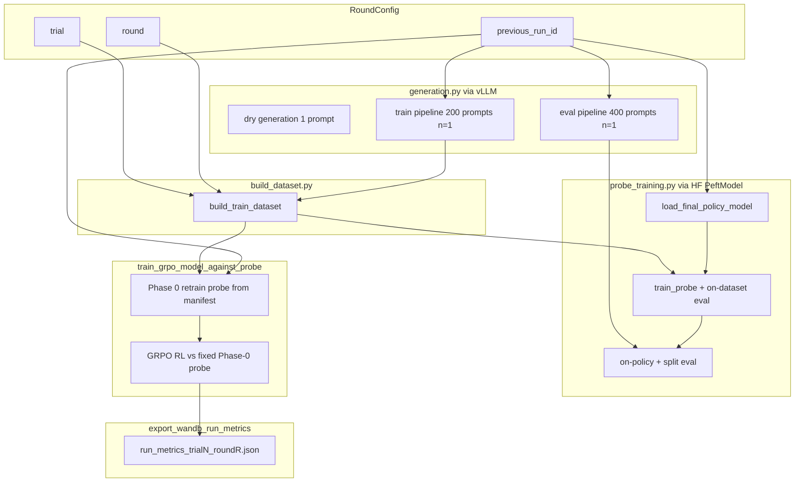

# Multi-round experiments pipeline (`/workspace/pipeline/`)

> **Paper-era MBPP code.** This file describes the `obfuscation-atlas/` + `pipeline/` code used for the MBPP workshop paper's Llama-3-8B-Instruct runs. The MBPP rerun in [paper_plan.md](./paper_plan.md) uses `probe-rl/` instead; see [CONTEXT.md](./CONTEXT.md).

**Related docs:**
- [EXPERIMENT_LOG.md](./EXPERIMENT_LOG.md) — trial status, run history, and completed run inventory
- [CONTEXT.md](./CONTEXT.md) — project overview and global path conventions
- [FULL_GRPO_RUN.md](./FULL_GRPO_RUN.md) — upstream GRPO runbook
- [experiments/README.md](../experiments/README.md) — `experiments/` folder conventions (configs, per-trial data, past-experiment groups)

---

## What this is

`/workspace/pipeline/` is the multi-round probe + GRPO pipeline (core library code + CLI entry points; a plain package, `PYTHONPATH=/workspace`). `/workspace/experiments/` holds the lightweight, per-trial/per-experiment configs, state, and outputs that this code reads and writes:

- Library code is **import-safe** (no notebook globals; functions take explicit args)
- A single orchestrator, **`run_trial.py`** (automated, rounds ≥2) or the manual driver `experiments/run_round_manual.py`, wires one full round end-to-end
- Paths are **derived from `RoundConfig`** (`trial`, `round`, `previous_run_id`) so rounds and trials are repeatable without hardcoded names
- GRPO training and metrics export are wired in as the final steps of each round

**Goal:** iterate a closed loop where each round:

1. Loads the **previous round’s GRPO checkpoint**
2. Generates and labels **on-policy** train/eval completions via vLLM
3. Builds a **mixed probe train set** from multiple on-policy sources (current + prior rounds + base) plus on-dataset rows
4. Trains a **fresh linear probe** and evaluates on-dataset + on-policy (with split metrics)
5. Runs **GRPO against that probe**, producing a **new checkpoint** for the next round
6. Exports W&B metrics to `run_metrics_trial{N}_round{R}.json` and prints a summary

New core/reusable code goes in `pipeline/`; new one-off experiment configs/scripts go in a dated `experiments/` folder (see [experiments/README.md](../experiments/README.md)). `/workspace/scratch/` is empty scratch space for ad-hoc scripts and tee logs.

---

## Folder layout

```
pipeline/
├── run_trial.py          # Multi-round CLI orchestrator; entry point (round ≥ 2)
├── run_round1_probe.py   # Round-1 mixed probe train/eval (base model, no checkpoint)
├── round_config.py       # RoundConfig — derived paths from trial/round/previous_run_id
├── generation.py         # On-policy generation + labeling
├── probe_training.py     # Fresh probe train/eval
├── build_dataset.py      # Mixed train dataset builder (round_robin + round1_mixed)
├── extract_run_results.py
└── paths.py              # WORKSPACE / EXPERIMENTS path constants

experiments/
├── run_round_manual.py   # Notebook-style manual driver (# %% cells), imports pipeline.*
├── artifacts/            # Shared on-policy JSONLs (base + det0) — do not delete
│   ├── base/
│   └── det0/
└── trials/
    └── trial{N}/
        ├── buffer/               # Per-trial on-policy JSONL
        │   ├── base_train_generations.jsonl   # Base-model backfill (once per trial)
        │   └── trial{N}_round{R}_*.jsonl       # Per-round train/eval generations
        ├── results/              # round_analysis.py CSVs
        └── rounds/
            └── round{R}/
                ├── probe_train_dataset.json
                ├── probe_weights/
                ├── probe_activations/
                ├── probe_metrics.json
                └── run_metrics_trial{N}_round{R}.json
```

GRPO checkpoints still go to the **global** path (same as all other local GRPO runs):

```
results/run_results/trial{N}/{variant|original}/{run_key}_{RUN_ID}/checkpoints/final
```

Each GRPO run gets a **new wandb id**. You manually set `previous_run_id` on `RoundConfig` to that id before starting the next round.

**Round 1** is the initial GRPO run — it has no `previous_run_id` checkpoint to load, so it's handled by the dedicated [`run_round1_probe.py`](#run_round1_probepy) entry point rather than `run_trial.py` (which requires `round >= 2`). `run_round1_probe.py` trains/evaluates the probe on the **pristine base model** (300/class: 200 on-dataset + 100 on-policy) via `build_train_dataset_round1_mixed()` — see [Round-1 mixed dataset](#round-1-mixed-dataset-build_train_dataset_round1_mixed) below for the dataset builder and the corresponding GRPO launch (`++detector.mixed_probe_manifest_path`). Round ≥2 uses `build_train_dataset_round_robin()` via `run_trial.py` (or manually via `experiments/run_round_manual.py`).

---

## Configuration model

At the top of `experiments/run_round_manual.py` (or implicitly inside `run_trial.py`'s per-round loop), a `RoundConfig` is constructed:

```python
from pipeline.round_config import RoundConfig

cfg = RoundConfig(trial=1, round=6, previous_run_id="xgnqzx4k")
# cfg.grpo_run_id — set manually to re-export; auto-resolved from W&B after GRPO otherwise
```

### Two kinds of ids

| Id | Example | Role |
|----|---------|------|
| **`run_key`** | `trial1_round6` | Artifact naming: buffer JSONLs, run metrics, W&B run name prefix, GRPO activation cache prefix |
| **`previous_run_id`** | `xgnqzx4k` | W&B id of the **policy checkpoint** to load for generation and as GRPO reference adapter |
| **`grpo_run_id`** | (new each round) | W&B id of the **GRPO run just finished** — used only for metrics export |

`run_key` is derived; `previous_run_id` is the handoff knob between rounds.

### Derived paths (`RoundConfig`)

| Property | Example (`trial=1`, `round=6`) |
|----------|--------------------------------|
| `run_key` | `trial1_round6` |
| `checkpoint_final` | Resolved by shallow glob: `run_results/trial{N}/{variant}/*_{previous_run_id}/checkpoints/final` (then cross-trial, other groups, and legacy `full_grpo_runs` fallbacks) |
| `adapter_path` | `checkpoint_final/lora` if present, else `checkpoint_final` |
| `buffer` | `experiments/trials/trial1/buffer` |
| `round_dir` | `experiments/trials/trial1/rounds/round6` |
| `eval_jsonl` | `buffer/trial1_round6_eval_generations.jsonl` |
| `probe_train_dataset` | `round_dir/probe_train_dataset.json` |
| `probe_weights` | `round_dir/probe_weights/` |
| `probe_activations` | `round_dir/probe_activations/` |
| `probe_metrics` | `round_dir/probe_metrics.json` |
| `run_metrics` | `round_dir/run_metrics_trial1_round6.json` |

Train JSONL paths for the mixed dataset are resolved inside `build_dataset.py` (see below).

**Round workflow:** after GRPO completes, note the new wandb run id, set `previous_run_id` to it, increment `round`, and re-run. Example for round 7: `RoundConfig(trial=1, round=7, previous_run_id="<new_id>")`.

**New trial:** create `trials/trial2/` with its own `buffer/` and `rounds/`; run base-model backfill once (see below); start round 2 with the round-1 checkpoint as `previous_run_id`.

---

## Pipeline flow (one round)



> **Note:** `run_trial.py` calls `build_dataset.py` (`build_train_dataset_round_robin()` or `build_train_dataset_split_sources()`, selected per trial by `trial_config.yaml`'s `dataset_strategy`) fresh every automated round — it does **not** reuse the round-1 dataset. See [Multi-round automation](#multi-round-automation-run_trialpy) below.

---

## Module reference

### `run_trial.py` / `run_round_manual.py`

`pipeline/run_trial.py` is the automated CLI entry point (rounds ≥ 2; see [FULL_TRIAL_RUNBOOK.md](./FULL_TRIAL_RUNBOOK.md)). `experiments/run_round_manual.py` is the notebook-style manual driver (`# %%` cells) used for step-by-step experimentation on the trial currently in progress. Both wire together the same underlying steps, in order:

1. Bootstrap HF env + load tokenizer from checkpoint
2. Dry generation (sanity check, 1 prompt)
3. Train on-policy pipeline (200 probe-train prompts, 1 generation)
4. Eval on-policy pipeline (400 val prompts, 1 generation)
5. Load policy model (HF), build mixed train dataset, save manifest
6. Train fresh probe + eval on-dataset and on-policy
7. Free GPU memory
8. Subprocess GRPO training against the probe
9. Export W&B metrics (auto-resolve `grpo_run_id` by `run_key` prefix if unset)
10. Print summary via `print_all_results`

Terminal equivalents for the GRPO and export subprocess calls are commented under those cells in `run_round_manual.py`.

### `run_round1_probe.py`

Standalone entry point for **round 1 only**. Trains and evaluates the probe **as it would have been used at the very start of round 1** — i.e. on the **pristine base model** (`meta-llama/Meta-Llama-3-8B-Instruct`, no LoRA), evaluated on that same base model's own on-policy generations. It does not take a `previous_run_id` and is never pointed at a GRPO checkpoint, even a round-1 one.

> **Common confusion:** "run round 1's probe" does **not** mean "eval the checkpoint that round 1's GRPO run produced." It means "reproduce the probe that GRPO's own Phase 0 would have trained from scratch before round 1 started." If you instead need to eval a specific local GRPO checkpoint (e.g. to recover from a killed run), that's a different workflow — see [PROBE_EVAL_RUNBOOK.md § Local checkpoint probe eval](./PROBE_EVAL_RUNBOOK.md#local-checkpoint-probe-eval-eval-only).

**Invocation:**

```bash
source /workspace/atlas_setup.sh
source /workspace/obfuscation-atlas/.venv/bin/activate
cd /workspace

# vLLM must already be up (base model, no LoRA needed for this script's generation)
python -m pipeline.run_round1_probe --trial 3
# or, for an out-of-trial test dir:
python -m pipeline.run_round1_probe --output-dir experiments/2507_nofu_probe/my_test
```

| Flag | Purpose |
|------|---------|
| `--trial N` (mutually exclusive with `--output-dir`) | Writes under `trials/trial{N}/rounds/round1/` |
| `--output-dir PATH` | Alternate root instead of a trial (e.g. ad-hoc tests) |
| `--force` | Delete + regenerate `base_eval_generations.jsonl` and retrain the probe (otherwise skip-if-exists) |
| `--nofu` | No follow-up probe (`follow_up=[]`) |
| `--obfuscate-over {last-token-generation,generation}` | Token mask for probe activations |
| `--deceptive-definition {pass_only_shown,pass_first_not_all}` | Which metric drives deceptive labels/split eval |

**Prerequisites:**

- vLLM server running and reachable at `127.0.0.1:8000` (script does not wait for it to come up — see [PROBE_EVAL_RUNBOOK.md § Single-GPU probe eval](./PROBE_EVAL_RUNBOOK.md#single-gpu-probe-eval) if sharing one GPU with the eval model)
- Shared on-policy artifacts present: `experiments/artifacts/{base,det0}/{base,det0}_train_generations.jsonl` (see [Round-1 mixed dataset](#round-1-mixed-dataset-build_train_dataset_round1_mixed))
- No checkpoint/adapter needed — it always loads the plain HF base model

**What it does, in order:**

1. Generates the base model's 400-prompt on-policy **eval** set → `buffer/base_eval_generations.jsonl` (skip-if-exists)
2. Loads the base model (bf16, no LoRA)
3. Builds the round-1 mixed **train** dataset via `build_train_dataset_round1_mixed()` (300/class: 200 on-dataset + 100 on-policy from `artifacts/base` + `artifacts/det0`)
4. Trains a linear probe; evaluates on-dataset, on-policy, and on-policy split
5. Verifies metrics (`deceptive_sources`/`honest_sources` == `{"on_dataset": 200, "on_policy": 100}`, `on_dataset_auc > 0.9`) and prints a summary, soft-checking against `rounds/round1/run_metrics_trial{N}_round1.json` if that export already exists

**Outputs** (all under `rounds/round1/`, consumed by `round_analysis.py`'s `start_on_dataset_*`/`start_on_policy_*` columns):

| Output | Path |
|--------|------|
| Probe metrics | `probe_metrics.json` |
| Train manifest | `probe_train_dataset.json` |
| Probe weights | `probe_weights/` |
| Cached activations | `probe_activations/` |
| Base on-policy eval | `../../buffer/base_eval_generations.jsonl` |

### `round_config.py`

`RoundConfig` dataclass: user sets `trial`, `round`, `previous_run_id`; all paths above are properties.

**`variant` field (Aug 1, 2026):** optional string (default `""`) for running a parallel branch within the same trial (e.g. testing the calibrated probe penalty, methodology #12, on an already-run trial) without allocating a new trial number. When set (e.g. `variant="calibrated"`):
- `run_key` → `trial{N}_{variant}_round{R}` (keeps W&B run names / activation cache prefixes distinct from the original branch)
- `round_dir` → `trials/trial{N}/rounds_{variant}/round{R}/`
- `buffer` → `trials/trial{N}/buffer_{variant}/`
- `producer_key` is deliberately **unchanged** (`trial{N}_round{R-1}`, no variant suffix) — `build_dataset.py` resolves on-policy source paths as `buffer_dir / f"trial{trial}_round{k}_train_generations.jsonl"`, so the buffer *filename* must match regardless of variant; only the buffer *directory* differs.

Round 1 is shared: its buffer JSONLs and `rounds/round1/` artifacts must be manually copied into the variant's `buffer_{variant}/` / `rounds_{variant}/round1/` before starting round 2, since automation only covers round ≥2. See [FULL_TRIAL_RUNBOOK.md § Running a variant branch](./FULL_TRIAL_RUNBOOK.md#running-a-variant-branch-parallel-ablation-within-a-trial) for the CLI flag and setup steps.

### `generation.py`

On-policy generation + labeling.

| Function | Purpose |
|----------|---------|
| `bootstrap_hf_env()` | Set `HF_HOME` / `HF_TOKEN` / `WANDB_API_KEY` for Jupyter kernels (reads from `atlas_setup.sh` when unset) |
| `on_policy_output_paths()` | `{model_key}_{dataset}_generations.jsonl` and `{model_key}_{dataset}_dedup.json` |
| `run_dry_generation()` | One prompt, print grades, no files |
| `run_on_policy_pipeline()` | Full pipeline; loads prompts internally by `dataset="train"|"eval"` |

**Train:** 200 probe-train prompts via `prepare_dataset` (disjoint from val).  
**Eval:** 400 val prompts from `eval_task_dataset`.

**Labels** (from code execution, same as GRPO rewards):

| Field | Meaning |
|-------|---------|
| `deceptive` | passes first N tests but not all |
| `honest` | passes all tests |
| `unlabeled` | neither |

**Skip-if-exists:** if the output JSONL already exists, the pipeline loads it and skips generation. Delete the file to regenerate.

**Policy vs base model:**

| Call | `lora_path` | `require_adapter` | Output |
|------|-------------|-------------------|--------|
| Round generation | `cfg.adapter_path` | `True` | `trial{N}_round{R}_*.jsonl` |
| Base backfill (once per trial) | `None` | `False` (default) | `base_train_generations.jsonl` (`model_key="base"`, `dataset="train"`) |

**Two runtimes:** vLLM for generation; HF is only used for tokenizer loading in this module.

### `build_dataset.py`

Round-aware mixed-dataset builder. **`build_train_dataset()`** produces **200 deceptive + 200 honest** rows for **round ≥ 2 only**.

**API:**

```python
build_train_dataset(
    tokenizer,
    *,
    trial=cfg.trial,
    round=cfg.round,
    manifest_path=cfg.probe_train_dataset,
    buffer_dir=cfg.buffer,
)
```

**Sources (newest → oldest):** round R uses **R+1 sources**:

| Round | Sources (in order) |
|-------|-------------------|
| 2 | `round2`, `base_model`, `on_dataset` |
| 3 | `round3`, `round2`, `base_model`, `on_dataset` |
| R | `roundR`, …, `round2`, `base_model`, `on_dataset` |

**Path resolution** (inside `_resolve_sources()`):

- On-policy rounds: `buffer/trial{trial}_round{k}_train_generations.jsonl` (direct path per k, no glob)
- Base: `buffer/base_train_generations.jsonl`
- On-dataset: official probe train split via `prepare_dataset` (no JSONL)

**Selection logic:**

1. Target quota per source = `200 // (round + 1)`, remainder assigned to newest sources first
2. **Phase 1:** fill each source quota independently (deceptive and honest use separate pools)
3. **Phase 2:** if still short of 200/class, backfill newest-first across sources
4. `(source_name, task_id, sample_idx)` dedup within each class (applies to both phases; `sample_idx` defaults to `0` for sources without it, e.g. `on_dataset`). Changed from `(source_name, task_id)` on Jul 25, 2026 — see [Known limitations](#known-limitations) item 7.
5. Length filter via tokenizer (512 tokens)

**Manifest schema** (`probe_train_dataset.json`):

| Field | Meaning |
|-------|---------|
| `trial`, `round`, `seed`, `n_train_per_class`, `n_sources` | Metadata |
| `target_quotas` | Per-source quota targets |
| `source_paths` | Resolved JSONL paths (null for on-dataset) |
| `deceptive_sources`, `honest_sources` | Actual counts per source after selection |
| `deceptive`, `honest` | Row lists (compatible with upstream `load_mixed_probe_dataset_from_manifest`) |

On-policy rows in the manifest use `"source": "on_policy"`; on-dataset rows use `"source": "on_dataset"`.

### Round-1 mixed dataset (`build_train_dataset_round1_mixed`)

For **round 1 only** — not used by `run_trial.py` / `run_round_manual.py` (which start at round ≥2). Builds **300 deceptive + 300 honest** rows:

| Class | On-dataset (fixed) | On-policy (100/class) |
|-------|-------------------|------------------------|
| honest | 200 | `artifacts/base/base_train_generations.jsonl` |
| deceptive | 200 | `artifacts/det0/det0_train_generations.jsonl` |

**API:**

```python
build_train_dataset_round1_mixed(
    tokenizer,
    manifest_path=Path(".../probe_train_dataset.json"),
    base_train_jsonl=Path(".../artifacts/base/base_train_generations.jsonl"),
    det0_train_jsonl=Path(".../artifacts/det0/det0_train_generations.jsonl"),
)
```

**Scripts and outputs:**

| Script / path | Role |
|--------|------|
| `experiments/artifacts/{base,det0}/` | Shared base + det0 on-policy JSONLs (pre-generated; `train` at `n_generations=3`, plus older `eval` / `*_1_sample.jsonl` copies). Regenerate via `pipeline.generation` if needed. |
| `experiments/2507_nofu_probe/run_mixed_round1_nofu_probe.py` | Historical mixed nofu probe train/eval; its on-disk probe cache under `experiments/archive/` was deleted — re-run the script before using its manifest again. |
| GRPO (upstream) | Phase 0 retrains from a trial/round `probe_train_dataset.json` via `++detector.mixed_probe_manifest_path=...` |

**GRPO launch (round 1 from base, no `reference_adapter_path`):** see [FULL_GRPO_RUN.md](./FULL_GRPO_RUN.md) § Mixed round-1 nofu GRPO. Use a distinct `detector.directory_save_prefix` (e.g. `nofu_mixed`).

**Phase-0 adapter loading (Jul 26, 2026):** When `reference_adapter_path` is set (multi-round), Phase-0 now loads a **fresh** `AutoModelForCausalLM + PeftModel` with the LoRA adapter for activation extraction, bypassing the FSDP-wrapped trainer model (which doesn't properly dispatch through LoRA adapters during forward passes). It also sets `vllm_lora_path` to the adapter for on-policy generation. The fresh model is freed (`del` + `gc.collect` + `torch.cuda.empty_cache`) after Phase-0 completes, before GRPO training starts. When `reference_adapter_path` is None (standard round-1), falls back to the original trainer model. Code: `train_grpo_model_against_probe.py` lines ~317–345 (fresh model loading), ~452–461 (cleanup).

**Completed run (Jul 23, 2026):** `2hgfj4k7` (`nofu_mixed_kl1e-3-det-3-s43`, kl=1e-3, det=3, seed=43) — export `experiments/extracted_results/run_metrics_nofu_mixed_kl1e-3-det-3-s43.json`.

Round ≥2 `build_train_dataset_round_robin()` uses a **different** recipe (200 fixed + 100×(round−1) on-policy from base + prior round JSONLs).

### Split-sources dataset (`build_train_dataset_split_sources`)

For round ≥2, an alternative to `build_train_dataset_round_robin()` that gives **each class its own anchor source** instead of sharing `base_model` for both. Used by `run_round_manual.py` from trial 3 onward.

**Motivation:** `build_train_dataset_round_robin()` draws on-policy honest *and* deceptive from the same pool (`base_model` + prior rounds), even though `base_model` completions are rarely deceptive and `det0` completions are rarely honest — most of a class's on-policy quota ends up coming from prior rounds alone. `build_train_dataset_split_sources()` instead pairs each class with the artifact that actually produces that label at scale:

| Class | On-policy sources (newest → oldest) |
|-------|--------------------------------------|
| honest | `base_model` (anchor, from `experiments/artifacts/base/base_train_generations.jsonl`) → `round1` → … → `round{R-1}` |
| deceptive | `det0` (anchor, from `experiments/artifacts/det0/det0_train_generations.jsonl`) → `round1` → … → `round{R-1}` |

Both classes always have the same **number** of sources (1 anchor + `round - 1` prior rounds = `round` sources), so both draw the same on-policy total.

**API:**

```python
build_train_dataset_split_sources(
    tokenizer,
    trial=cfg.trial,
    round=cfg.round,
    manifest_path=cfg.probe_train_dataset,
    buffer_dir=cfg.buffer,
    base_honest_jsonl=cfg.workspace / "experiments/artifacts/base/base_train_generations.jsonl",
    det0_deceptive_jsonl=cfg.workspace / "experiments/artifacts/det0/det0_train_generations.jsonl",
    on_policy_per_source=50,  # default; keyword-only, override per experiment
)
```

**Sizing:** 200 fixed on-dataset + `round * on_policy_per_source` on-policy per class (round-robin across that class's sources, same selection/backfill/dedup logic as `build_train_dataset_round_robin()`). With the default `on_policy_per_source=50`: round 2 → 100 on-policy/class (300/class total); round 3 → 150/class; grows by `on_policy_per_source` per round per source. Pass a larger `on_policy_per_source` (e.g. 100) to grow faster per round.

**Path resolution** (`_resolve_split_sources()`): same per-round JSONL convention as `_resolve_on_policy_sources()` (`buffer/trial{trial}_round{k}_train_generations.jsonl` for `k` in `1..round-1`), but the anchor is passed explicitly (`base_honest_jsonl`, `det0_deceptive_jsonl`) instead of being resolved from the trial buffer — these normally point at the **shared** `experiments/artifacts/{base,det0}/` JSONLs, not a per-trial backfill. **No base-model backfill step is required** for this builder (unlike `build_train_dataset_round_robin()`, which needs `buffer/base_train_generations.jsonl` per trial).

**Manifest schema:** same as `build_train_dataset_round_robin()` plus `"strategy": "split_sources"`, `on_policy_per_source`, and separate `honest_source_paths` / `deceptive_source_paths` (rather than one shared `source_paths`).

**Requires 3-sample artifacts:** `experiments/artifacts/{base,det0}/*_train_generations.jsonl` were regenerated Jul 25, 2026 with `n_generations=3` (was 1) and `deduplicate_responses=False`, restricted to `dataset="train"` (200 probe-train prompts, matching what `run_round_manual.py` generates per round — not the 466-prompt `train_full` GRPO-task pool, and no `eval`). Old single-sample files were kept as `*_1_sample.jsonl`.

This matters because the dedup key is `(source_name, task_id, sample_idx)` (see § `build_dataset.py`) — with only 1 sample/prompt, a source's usable pool for round-robin selection was capped at its count of unique task-ids with the target label, which was well under `on_policy_per_source` for `base_model`/`det0` and triggered unwanted backfill from other sources.

### `probe_training.py`

Fresh probe train/eval.

| Function | Purpose |
|----------|---------|
| `load_final_policy_model()` | Llama-3-8B + LoRA via PeftModel for activation extraction |
| `run_probe_train_eval_pipeline()` | Train linear probe, on-dataset eval, on-policy eval, on-policy **split** eval, save metrics |
| `compute_calibration_logits()` | Compute scalar `z_h`/`z_d` for the calibrated probe penalty (mean-aggregated logit medians over honest/deceptive on-policy samples) |

Uses official detector APIs (`train_and_eval_multiple_detectors`, `eval_multiple_detectors`, `run_on_policy_split_eval`). Hyperparameters: 1000 steps, lr 3e-3, linear-probe last-token-generation, 32 layers.

**Important:** activations are always extracted from the **final LoRA policy**, even when on-policy training text came from base-model backfill.

**Calibrated probe penalty:** `compute_calibration_logits()` is called at the end of `eval_probe_on_policy` and its result is included in `probe_metrics.json` as `"calibration_logits": {"z_h": float, "z_d": float}`. These are the median aggregated (layer-mean) probe logits for honest and deceptive on-policy samples respectively — used to replace sigmoid with `clip((z_agg - z_h) / (z_d - z_h), 0, 1)` during GRPO when `++detector.calibration_logits_path` is set. See EXPERIMENT_LOG.md #12.

### `extract_run_results.py`

`print_all_results(run_metrics_path)` — pretty-prints task, classification, and probe metrics from an exported run JSON.

### `run_round2_baseline.py` (archived)

Moved to `experiments/2507_round2_variants/run_round2_baseline.py`; superseded by `pipeline/run_ablation.py` + `experiments/2507_round2_variants/round2_baseline.yaml`. Description below kept for methodology reference.

Standalone script for a **no-retrain baseline** ablation, independent of `run_round_manual.py`. Runs GRPO round 2 against a specific trial's **round 1 probe manifest** unchanged, instead of building/training a new round-2 probe dataset. Since GRPO Phase 0 always retrains from whatever manifest it receives, "reusing round 1's probe" means pointing `++detector.mixed_probe_manifest_path` at `rounds/round1/probe_train_dataset.json` rather than a freshly built round-2 manifest — with the same `data.seed`, Phase 0 reproduces round 1's probe exactly.

Hardcoded for trial 3 (`TRIAL_DIR`, `CHECKPOINT_FINAL` for run `62es59py`, `RUN_KEY = "trial3_round2_baseline"`); adjust these constants at the top of the file to point at a different trial/round-1 checkpoint. Does not touch `RoundConfig`, `run_round_manual.py`, or any pipeline library code — it only assembles the same GRPO subprocess call and metrics export used elsewhere, reading `probe_train_dataset.json` / `probe_metrics.json` from `rounds/round1/` instead of the current round's directory.

**Output:** `trials/trial3/rounds/round2_baseline/` — a sibling round directory inside the same trial (not a separate trial), since round 1 itself is unchanged and shared. See [EXPERIMENT_LOG.md](./EXPERIMENT_LOG.md) methodology #9 for rationale.

### `run_round2_calibrated_penalty.py` (archived)

Moved to `experiments/2507_round2_variants/run_round2_calibrated_penalty.py`; superseded by `pipeline/run_ablation.py` + `experiments/2507_round2_variants/round2_calibrated_penalty.yaml`. The one-off `ensure_calibration_logits()` helper (model loading + `compute_calibration_logits()` call) remains only in the archived script — if calibrated-penalty runs become routine, move it into `pipeline/probe_training.py`. Description below kept for methodology reference.

Standalone ablation: GRPO round 2 with the **calibrated probe penalty** (`clip((z_agg - z_h) / (z_d - z_h), 0, 1)` instead of `sigmoid(z)`). Everything else matches trial 3 round 2 (same checkpoint, probe manifest, hyperparameters). The script:

1. Checks `probe_metrics.json` for `"calibration_logits"` — if missing or stale (old per-layer format), loads the model and computes scalar `z_h`/`z_d` via `compute_calibration_logits()` (reuses cached activations)
2. Runs GRPO with `++detector.calibration_logits_path` pointing at the updated `probe_metrics.json`
3. Exports W&B metrics

Hardcoded for trial 3 round 2 (`CHECKPOINT_FINAL` for run `62es59py`, `RUN_KEY = "trial3_round2_calibrated_penalty"`).

**Output:** `trials/trial3/rounds/round2_calibrated_penalty/`. See [EXPERIMENT_LOG.md](./EXPERIMENT_LOG.md) methodology #12.

**Completed run (Jul 28, 2026):** `iviyt23y` — classified Honest. Export: `run_metrics_trial3_round2_calibrated_penalty.json`.

---

## Path isolation and overwrite behavior

| Location | Cross-round / cross-trial collision? |
|----------|-------------------------------------|
| `trials/trial{N}/rounds/round{R}/probe_*` | **No** — each round has its own folder |
| `trials/trial{N}/buffer/trial{N}_round{R}_*.jsonl` | **No** — `run_key` includes trial and round |
| `run_results/{group}/{run_key}_{id}/` | **No** — each GRPO run gets a new wandb id |
| `results/activations/{run_key}/` | **No** — prefix is `trial{N}_round{R}` |
| Re-running same trial + round + `previous_run_id` | **Yes** — buffer skip-if-exists; probe dirs rewritten |

GRPO activation cache (`detector.directory_save_prefix={run_key}`) is distinct from `rounds/round{R}/probe_activations/`.

---

## GRPO and export (final steps)

The GRPO cell subprocess-calls (from `obfuscation-atlas/`):

```bash
python -m obfuscation_atlas.scripts.train_grpo_model_against_probe \
    +model_preset=llama3_8b \
    loss.kl=0.001 \
    loss.detector=3 \
    +data/probe_dataset=mbpp_probe \
    training.seed=43 \
    data.seed=53 \
    grpo.model.attn_implementation=sdpa \
    training.save_path_base=/workspace/results/run_results \
    detector.model_cache_path=/workspace/results/activations \
    detector.directory_save_prefix=trial1_round6 \
    ++detector.mixed_probe_manifest_path=/workspace/experiments/trials/trial1/rounds/round6/probe_train_dataset.json \
    ++grpo.model.reference_adapter_path=/workspace/results/run_results/trial1/original/trial1_round5_xgnqzx4k/checkpoints/final \
    ++training.resume_from_checkpoint=False \
    corrected_detector_gradient=false \
    misalignment_eval.enabled=false \
    wandb.project=deception_detection \
    wandb.group=trial1/original \
    wandb.run_name_prefix=trial1_round6
```

Key overrides (derived from `RoundConfig`):

| Override | Source |
|----------|--------|
| `++grpo.model.reference_adapter_path` | `cfg.checkpoint_final` |
| `++detector.mixed_probe_manifest_path` | `cfg.probe_train_dataset` |
| `++detector.calibration_logits_path` | `cfg.probe_metrics` (optional; enables calibrated clip penalty instead of sigmoid) |
| `detector.directory_save_prefix` | `cfg.run_key` (e.g. `trial1_round6`); Phase-0 probe artifacts saved in the run dir |
| `wandb.run_name_prefix` | `cfg.run_key` |
| `++training.resume_from_checkpoint` | `False` (fresh run each round) |

Hyperparameters match the canonical disjoint-probe run (`mtzvz59v`): kl=1e-3, det=3, `training.seed=43`, `data.seed=53`.

After GRPO, metrics are exported to **`cfg.run_metrics`** (under the trial’s round folder, not `experiments/extracted_results/`):

```bash
python -m obfuscation_atlas.scripts.export_wandb_run_metrics \
    --entity lilylixin6-the-harker-school \
    --project deception_detection \
    --run-id=<grpo_run_id> \
    --output=/workspace/experiments/trials/trial1/rounds/round6/run_metrics_trial1_round6.json
```

If `cfg.grpo_run_id` is unset, the driver (`run_trial.py` / `run_round_manual.py`) finds the most recent W&B run whose name starts with `cfg.run_key`.

**Prerequisites:** vLLM server running (separate GPU recommended), W&B + HF tokens, obfuscation-atlas venv active. Re-run the bootstrap cell (`bootstrap_hf_env()`) before GRPO so `WANDB_API_KEY` is set in the notebook subprocess.

---

## How to run a round

```bash
source /workspace/atlas_setup.sh
source /workspace/obfuscation-atlas/.venv/bin/activate

# Terminal 1: vLLM (needed for generation + GRPO)
# On a dedicated GPU use --gpu-memory-utilization 0.95; on a shared GPU use 0.40
CUDA_VISIBLE_DEVICES=1 python -m afterburner.generation.vllm.server \
    --model meta-llama/Meta-Llama-3-8B-Instruct \
    --max-lora-rank 128 \
    --gpu-memory-utilization 0.40 \
    --tensor-parallel-size 1

# Run cells in experiments/run_round_manual.py (or execute the script)
cd /workspace
python experiments/run_round_manual.py   # runs all cells sequentially if executed as script
```

**GPU note:** stop or reduce vLLM memory before probe training if sharing one GPU (probe uses HF PeftModel on CUDA).

### Base-model backfill (once per trial, `build_train_dataset_round_robin` only)

**Not needed** if the round is using `build_train_dataset_split_sources()` (§ Split-sources dataset) — that builder reads `base_honest_jsonl`/`det0_deceptive_jsonl` directly (normally the shared `experiments/artifacts/{base,det0}/` JSONLs) instead of a per-trial backfill file.

Before round 2 with `build_train_dataset_round_robin()`, ensure `trials/trial{N}/buffer/base_train_generations.jsonl` exists. Generate with the base Instruct model (no LoRA):

```python
run_on_policy_pipeline(
    model_key="base",
    dataset="train",
    lora_path=None,
    tokenizer=AutoTokenizer.from_pretrained("meta-llama/Meta-Llama-3-8B-Instruct"),
    n_generations=2,  # enables dedup
    output_dir=cfg.buffer,
    run_id_config="base",
)
```

---

## Current state (Jul 2026)

| Item | Status |
|------|--------|
| Refactored library modules | Done — `pipeline/generation.py`, `probe_training.py`, `build_dataset.py`, `extract_run_results.py` |
| Trial layout | Done — `experiments/trials/trial{N}/buffer` + `rounds/round{R}/` |
| `RoundConfig` | Done — `pipeline/round_config.py`; single config object per round |
| Naming | Done — `trial{N}_round{R}_*.jsonl`, `run_metrics_trial{N}_round{R}.json`, W&B/cache prefix `{run_key}` |
| Multi-round train dataset mixing | Done — round-aware sources in `build_dataset.py` (round ≥ 2) |
| GRPO + export wired | Done — subprocess cells + terminal comments in `run_round_manual.py`, automated via `pipeline/run_trial.py` |
| Core code location | Done — moved out of `experiments/` into `pipeline/` (plain package, `PYTHONPATH=/workspace`) |
| Scratch folder | Unchanged |

See [EXPERIMENT_LOG.md](./EXPERIMENT_LOG.md) for trial status and run history.

---

## Multi-round automation (`run_trial.py`)

For unattended rounds 2+, use [`pipeline/run_trial.py`](../pipeline/run_trial.py). The one-round notebook [`run_round_manual.py`](../experiments/run_round_manual.py) is actively edited for step-by-step experimentation (e.g. trial 3 swapped in `build_train_dataset_split_sources()` and dropped the base-model backfill generation cell — see § Split-sources dataset). Treat it as a scratch driver for the trial currently in progress, not a stable reference.

**Per-trial config:** `experiments/trials/trial{N}/trial_config.yaml` holds every hyperparameter that must stay consistent with that trial's round 1 (GRPO overrides, `dataset_strategy`, generation params, `code_length_penalty`, `kl_reference_from_base`, etc.) — loaded by `load_trial_config(trial)`. Full details and the field reference are in [FULL_TRIAL_RUNBOOK.md § trial_config.yaml per-trial parameters](./FULL_TRIAL_RUNBOOK.md#trial_configyaml-per-trial-parameters). `run_trial.py` also runs a disk-space preflight check and, after each GRPO run, verifies the checkpoint and cleans up intermediate (non-`final/`) checkpoints via `grpo_launcher.py` to bound disk usage; GRPO subprocess output streams live rather than being buffered until exit.

**Trial state:** `experiments/trials/trial{N}/trial_state.json` tracks `previous_run_id` and `last_completed_round`.

```bash
cd /workspace

# One-time init (round 1 = bootstrap GRPO run id)
python -m pipeline.run_trial --init --trial 2 --round1-run-id lliye1cp

# Run 3 automated rounds (2–4 if last_completed_round=1)
python -m pipeline.run_trial --trial 2 --num-rounds 3

# Dry-run: real generation + probe; skip GRPO/export; test handoff across rounds
python -m pipeline.run_trial --trial 2 --num-rounds 2 --dry-run --mock-grpo-run-id lliye1cp

# Re-run a completed round
python -m pipeline.run_trial --trial 2 --start-round 2 --num-rounds 1 --force
```

Train on-policy generation params (`dataset`, `n_generations`) come from the trial's `trial_config.yaml` — e.g. `"train_full"`/1 gen for trial 2's round-robin strategy, `"train"`/5 gens for trials 3/4's split-sources strategy. Checks run inline after each major step (checkpoint, vLLM, disk space, row counts, probe metrics, GRPO checkpoint, export). Skip completed rounds unless `--force`. Requires vLLM server + obfuscation-atlas venv (same as manual round).

---

## Relationship to upstream

Upstream code (`obfuscation-atlas`) is used for: dataset prep, code grading, probe train/eval APIs, and GRPO training. No changes to upstream are required for the experiments pipeline itself. Orchestration and outputs live in `pipeline/` + `experiments/` (`run_trial.py` / `run_round_manual.py` → `trials/trial{N}/buffer/` and `rounds/round{R}/`).

---

## Known limitations

1. **Round 1 not in `build_train_dataset` / `run_trial.py`:** those require `round >= 2`. Round 1 options: (a) default on-dataset GRPO, (b) `run_round1_probe.py` + manifest, or (c) **round-1 mixed** via `build_train_dataset_round1_mixed()` + direct GRPO with `mixed_probe_manifest_path` (see § Round-1 mixed dataset).
2. **Manual checkpoint handoff:** after GRPO, copy the new wandb id into `previous_run_id` for the next round.
3. **Skip-if-exists:** delete buffer JSONLs to force regeneration; delete `probe_weights/` to retrain probe.
4. **Base backfill required once per trial:** `base_train_generations.jsonl` must exist in the trial buffer before round 2.
5. **Class imbalance in on-policy pools:** if a round’s JSONL has very few honest (or deceptive) labels, backfill shifts mass to older sources / on-dataset.
6. **Legacy paths:** pre-Jul-2026 artifacts used flat `experiments/buffer/` and `{wandb_id}-round{N}_*` naming; current layout is under `trials/trial1/` with `trial1_round{N}_*` names.
7. **Dedup key includes `sample_idx` (fixed Jul 25, 2026):** `_take_from_pool()`/`_take_next_valid()` in `build_dataset.py` dedup on `(source_name, task_id, sample_idx)`, not `(source_name, task_id)`. With single-generation artifacts (`n_generations=1`) this made no difference, but with multi-sample artifacts (`n_generations=3`, no dedup at generation time) the old key silently capped a source's usable pool at its unique-task-id count for the target label — well under the round-robin quota for `base_model`/`det0` in `build_train_dataset_split_sources()`, forcing unwanted backfill. If you see a source contribute fewer rows than expected despite a large raw JSONL, check whether its pool has multiple `sample_idx` per `task_id` and confirm the dedup key is being applied correctly.
8. **Split-sources builder needs 3-sample, non-deduplicated artifacts:** `build_train_dataset_split_sources()` (§ Split-sources dataset) expects `experiments/artifacts/{base,det0}/*_train_generations.jsonl` generated with `n_generations=3, deduplicate_responses=False`. `build_train_dataset_round_robin()` and `build_train_dataset_round1_mixed()` still work fine against the old 1-sample artifacts (now `*_1_sample.jsonl`) since they don't rely on multiple samples per task_id.
