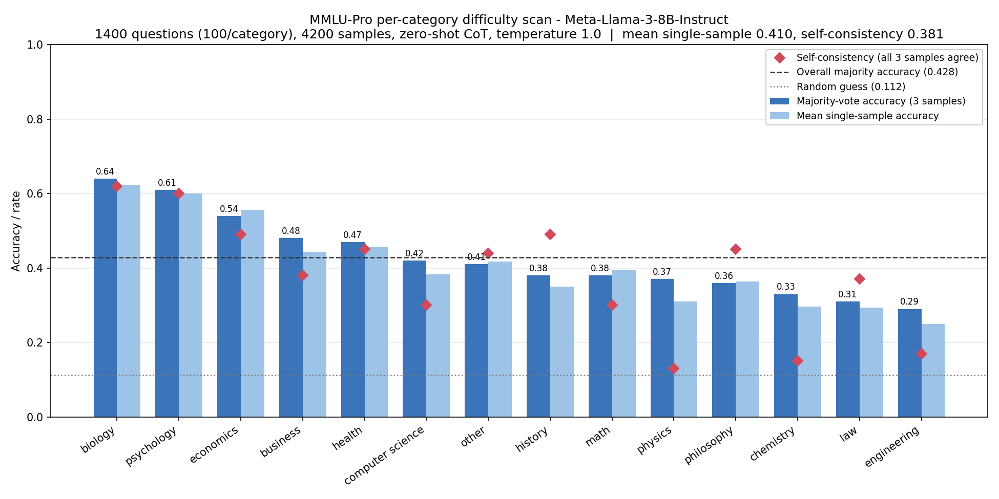

# MMLU-Pro per-category difficulty scan (2026-08-11)

Inference-only scan of `meta-llama/Meta-Llama-3-8B-Instruct` over all 14 MMLU-Pro
categories, to inform category selection for a new RL training domain. Questions
are used **verbatim** -- no modifications, no sycophancy pressure, no training.

## Headline result

Overall majority-vote accuracy **0.428** (mean single-sample 0.410) on 1400
questions x 3 samples. Per-category accuracy spans **0.29 (engineering) to 0.64
(biology)** -- a 2.2x spread, so category choice materially changes task difficulty.



| category | majority acc | sample acc | self-consistency | parse fail |
|---|---|---|---|---|
| biology | 0.640 | 0.623 | 0.620 | 0.000 |
| psychology | 0.610 | 0.600 | 0.600 | 0.000 |
| economics | 0.540 | 0.557 | 0.490 | 0.007 |
| business | 0.480 | 0.443 | 0.380 | 0.023 |
| health | 0.470 | 0.457 | 0.450 | 0.000 |
| computer science | 0.420 | 0.383 | 0.300 | 0.010 |
| other | 0.410 | 0.417 | 0.440 | 0.003 |
| history | 0.380 | 0.350 | 0.490 | 0.017 |
| math | 0.380 | 0.393 | 0.300 | 0.007 |
| physics | 0.370 | 0.310 | 0.130 | 0.027 |
| philosophy | 0.360 | 0.363 | 0.450 | 0.000 |
| chemistry | 0.330 | 0.297 | 0.150 | 0.030 |
| law | 0.310 | 0.293 | 0.370 | 0.003 |
| engineering | 0.290 | 0.250 | 0.170 | 0.023 |
| **OVERALL** | **0.428** | **0.410** | **0.381** | **0.011** |

Self-consistency = fraction of questions where all 3 samples parsed to the same
letter. Random-guess baseline is 0.112 (mean of 1/n_options over the scan set).

## Reading the numbers for category selection

- **Accuracy and consistency come apart.** `history` (0.38 accuracy, 0.49
  consistency) is confidently wrong; `physics` (0.37 accuracy, 0.13 consistency)
  is barely better than guessing per sample and disagrees with itself. Both look
  equally "hard" by accuracy alone but behave very differently under sampling.
- **Mid-range, high-consistency categories give the cleanest RL signal**: accuracy
  far enough from ceiling and floor to move, with stable enough sampling that a
  reward difference is not swamped by variance. `health`, `other`, and `business`
  sit closest to that profile; `economics` is slightly easier but still stable.
- **Ceiling/floor risks:** `biology` and `psychology` are the easiest (least
  headroom); `engineering`, `law`, and `chemistry` are hardest and pair low
  accuracy with low consistency, so gradients there will be noisy.

## Method

Conventions follow [TIGER-AI-Lab/MMLU-Pro](https://github.com/TIGER-AI-Lab/MMLU-Pro)
(`evaluate_from_local.py`) except where noted.

- **Data:** `TIGER-Lab/MMLU-Pro` `test` split. `"N/A"` padding options dropped, per
  the reference preprocessing. Each category shuffled with `random.Random(42)`
  after sorting by `question_id` (so sampling does not depend on hub row order),
  then the first 100 taken. 1400 questions total.
- **Prompt (deviation):** **zero-shot chat**, not the reference 5-shot completion
  prompt. The question and options go in a single user message under the
  reference answer-format instruction, via the Llama-3 chat template with
  `add_generation_prompt=True`. The reference 5-shot prompt was tried first and
  failed badly in chat format: Llama-3-8B-Instruct reads the few-shot blob as
  conversation setup and replies "go ahead and provide the next question"
  instead of answering. Only **23%** of those completions matched the primary
  `answer is (X)` regex, versus **87%** zero-shot (measured on the same
  questions). Zero-shot chat is also closer to how the eventual RL domain
  will present questions. The answer-format instruction ("finish your answer with
  \"the answer is (X)\"") is kept verbatim so the reference extraction still applies.
- **Sampling:** 3 samples per question, temperature 1.0, `max_tokens=2048`. Every
  completion terminated on EOS -- no truncation. Each question uses seed
  `42 + question_id`, so a resumed run reproduces an uninterrupted one exactly.
- **Extraction:** reference three-stage regex chain -- `answer is (X)`, then
  `answer: X`, then the last standalone `A-J` token.
- **Scoring (deviation):** unparseable completions are **not** scored as a random
  guess (the reference does this). They get `pred=None`, count as incorrect, and
  are reported via `parse_fail_rate`. Majority vote ignores unparsed samples; a
  question with all 3 unparsed is incorrect. Ties break toward the earliest sample.

### Extraction quality

87.4% of samples matched the primary `answer is (X)` regex, 11.5% fell through to
the last-letter fallback, and 1.1% were unparseable. The fallback is real signal,
not noise: 31.8% accurate versus 11.2% chance. A more permissive primary regex
(allowing `answer is:\n\nC.`) would change the extracted letter for only 26 of
4200 samples, so the choice of convention does not move the headline numbers.

## Scripts

Run from this directory with the `obfuscation-atlas` venv:

```bash
source /workspace/atlas_setup.sh
source /workspace/obfuscation-atlas/.venv/bin/activate
```

| Step | Command | Output |
|---|---|---|
| 1. Sample | `python build_scan_set.py` | `scan_set.jsonl` |
| 2. Generate | `CUDA_VISIBLE_DEVICES=0 python generate_completions.py` | `completions/`, `completions.jsonl` |
| 3. Score | `python score_completions.py` | `scores.jsonl`, `category_summary.csv` |
| 4. Plot | `python plot_results.py` | `category_accuracy.png` |

Step 2 needs a GPU and should run in tmux (~2 min on one H100, plus ~1 min model load):

```bash
tmux new-session -d -s mmlu_scan \
  'source /workspace/atlas_setup.sh && source /workspace/obfuscation-atlas/.venv/bin/activate && \
   cd /workspace/sycophancy_experiments/260811_mmlu_scan && \
   CUDA_VISIBLE_DEVICES=0 python generate_completions.py 2>&1 | tee generation.log'
```

Useful flags: `--dry-run` (2 questions/category into a separate cache),
`--categories math physics`, `--n-samples`, `--temperature`, `--merge-only`.

### Resumability

`generate_completions.py` appends to a per-category cache in `completions/` after
every batch and only generates `(question_id, sample_idx)` pairs that are missing,
so it is safe to kill and restart. A hard kill can leave a torn final line; the
loader skips unparseable lines, and appends re-terminate the line first so a torn
line cannot swallow the next record. Both full and partial resume were tested,
including recovery from a deliberately corrupted cache file.

## Files

```
build_scan_set.py        # step 1: sample 100 questions/category, seed 42
generate_completions.py  # step 2: zero-shot chat prompts, 3 samples, resumable
score_completions.py     # step 3: regex extraction, majority vote, per-category CSV
plot_results.py          # step 4: grouped bar chart
scan_set.jsonl           # 1400 sampled questions
completions/             # per-category append-only cache (resume state)
completions.jsonl        # 4200 merged completions with prompt + metadata
scores.jsonl             # per-question predictions, stages, correctness
category_summary.csv     # per-category metrics
category_accuracy.png    # chart
generation.log           # tee'd log from the full run
```
