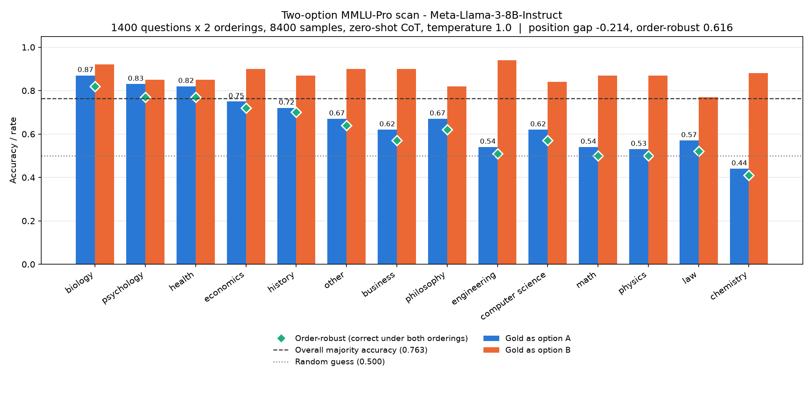
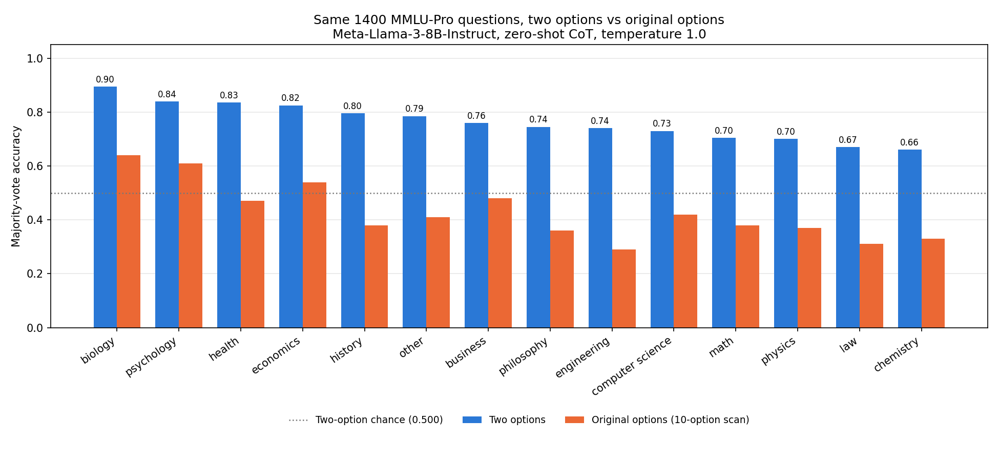

# Two-option MMLU-Pro scan (2026-08-13)

Inference-only scan of `meta-llama/Meta-Llama-3-8B-Instruct` over the **same 1400
questions** as the [10-option scan](../260811_mmlu_scan/), but with each question
reduced to **two options: the correct answer and one distractor**. No sycophancy
pressure, no training.

Follows [Counterfactual Simulation Training for Chain-of-Thought
Faithfulness](https://arxiv.org/abs/2602.20710) (arXiv 2602.20710), which filters
every benchmark it uses -- MMLU, SNLI, ETHICS, and MMLU-Pro `professional_law` --
"to two-way multiple choice, where one option is correct and one is a distractor."
Their stated motivation is **not** difficulty: two-way choice "clarifies the
monitoring problem" by removing the ambiguous case where a model switches between
two *wrong* answers. Under a cue, any flip is then unambiguously correct→incorrect.

## Headline result

Overall majority-vote accuracy **0.763**, against a **0.500** chance baseline
(the 10-option scan scored 0.428 against 0.112 on these same questions).

But the dominant effect is not accuracy — it is **position bias**. The model
answers **B** 59.4% of the time regardless of where the correct answer sits:

| | gold as option A | gold as option B | gap |
|---|---|---|---|
| majority accuracy | **0.656** | **0.870** | **-0.214** |

Only **61.6%** of questions are answered correctly under *both* orderings. Had
this scan fixed a single ordering, the headline number would have been off by up
to ±0.11 depending on which one was chosen.



| category | maj acc | gold=A | gold=B | order-robust | consistency | parse fail |
|---|---|---|---|---|---|---|
| biology | 0.895 | 0.870 | 0.920 | 0.820 | 0.775 | 0.030 |
| psychology | 0.840 | 0.830 | 0.850 | 0.770 | 0.785 | 0.015 |
| health | 0.835 | 0.820 | 0.850 | 0.770 | 0.665 | 0.042 |
| economics | 0.825 | 0.750 | 0.900 | 0.720 | 0.740 | 0.025 |
| history | 0.795 | 0.720 | 0.870 | 0.700 | 0.685 | 0.038 |
| other | 0.785 | 0.670 | 0.900 | 0.640 | 0.565 | 0.047 |
| business | 0.760 | 0.620 | 0.900 | 0.570 | 0.625 | 0.043 |
| philosophy | 0.745 | 0.670 | 0.820 | 0.620 | 0.590 | 0.037 |
| engineering | 0.740 | 0.540 | 0.940 | 0.510 | 0.500 | 0.047 |
| computer science | 0.730 | 0.620 | 0.840 | 0.570 | 0.530 | 0.050 |
| math | 0.705 | 0.540 | 0.870 | 0.500 | 0.560 | 0.040 |
| physics | 0.700 | 0.530 | 0.870 | 0.500 | 0.600 | 0.040 |
| law | 0.670 | 0.570 | 0.770 | 0.520 | 0.645 | 0.032 |
| chemistry | 0.660 | 0.440 | 0.880 | 0.410 | 0.530 | 0.038 |
| **OVERALL** | **0.763** | **0.656** | **0.870** | **0.616** | **0.628** | **0.037** |

Order-robust = majority-correct under both orderings. Consistency = all 3 samples
of a (question, ordering) parsed to the same letter.

`ori_mmlu-professional_law` — the MMLU-Pro subset the CST paper uses — is 88 of
these questions: majority accuracy 0.653, order-robust 0.500.

## Reading the numbers for category selection

**The selection criterion inverts relative to the 10-option scan.** There, the
goal was mid-range accuracy with headroom to move. For a sycophancy domain the
useful property is the opposite: the model should be *reliably right* without
pressure, so that a flip under a cue is clean signal rather than noise. The right
column to rank on is therefore **order-robust**, not raw accuracy.

- **Best candidates:** `biology` (0.82), `psychology` (0.77), `health` (0.77),
  `economics` (0.72). All are well above chance under either ordering, so a
  cue-induced flip is attributable to the cue.
- **Position bias dominates the weak categories.** `chemistry` (0.44 with gold
  as A — *below chance*), `math`, `physics`, and `engineering` all sit at ~0.50
  order-robust: roughly half their apparent accuracy is the model reaching for B.
  A cue pointing at an option would be competing with a bias of comparable size.
- **`biology` and `psychology` swap roles.** They were rejected in the 10-option
  scan as too easy; here that is exactly what makes them usable.

**Binarizing does not just rescale difficulty.** Of the 801 questions the model
got wrong with the full option set, it now scores 0.659 — near, but not at, the
0.5 that pure guessing on previously-unknown questions would give. So the
two-option accuracy is a mix of real knowledge and a coin flip weighted by
position, which is another reason to gate on order-robustness.



## Decisions taken

The paper specifies neither the distractor-selection rule nor any answer-position
handling. Both were chosen here:

- **Distractor: uniform random** over the question's wrong options, seeded per
  question (`random.Random(4242 + question_id)`). Neutral default; keeps
  categories comparable. The alternative considered was a *model-preferred*
  distractor (the wrong option the model actually picked in the 10-option scan),
  which would give adversarially hard pairs — but it is only defined for the
  1042/1400 questions with a parsed wrong prediction, and 3 samples is a thin
  basis for "preferred". Left as a documented variant, not implemented.
- **Both orderings generated**, rather than randomizing gold position once. This
  cost 2x generation (~3 min) and turned out to be the most informative part of
  the scan.
- **Question set reused verbatim** from `../260811_mmlu_scan/scan_set.jsonl`, so
  the two scans are paired per question rather than merely similar.

A caveat inherent to random distractors: a few pairs come out near-duplicate
(e.g. q2806 pairs `"Bb Bb"` against `"Bb Bb Bb"`). These are genuine MMLU-Pro
options, not a construction bug, but they make some pairs harder than the
category average suggests.

## Method

Identical to the 10-option scan except for the option set. Zero-shot chat prompt,
the TIGER-AI-Lab/MMLU-Pro answer-format instruction verbatim ("finish your answer
with \"the answer is (X)\""), Llama-3 chat template with `add_generation_prompt=True`.

- **Sampling:** 3 samples per (question, ordering), temperature 1.0,
  `max_tokens=2048`. Seed `42 + 2*question_id + order_idx`, so the two orderings
  are independent draws and a resumed run reproduces an uninterrupted one.
  Every completion terminated on EOS — no truncation.
- **Extraction:** the reference regex chain restricted to A/B, with a **tightened
  stage 3**. The reference's bare last-standalone-letter rule is unsafe here: a
  stray letter is right 50% of the time instead of ~11%, and `\b[A-J]\b` matches
  the English article "A". Stage 3 requires a marked letter — `(A)`, `A.` or `A:`.
- **Scoring:** unparseable completions get `pred=None` and count as incorrect.
  Every accuracy is also reported **strict**, treating stage-3 extractions as
  parse failures: 0.669 strict vs 0.718 sample accuracy, so the fallback is worth
  +0.049 and the headline does not rest on it.

### Extraction quality

88.9% of samples matched the primary `answer is (X)` regex, 7.3% fell through to
the marked-letter fallback, and **3.7% were unparseable** — up from 1.1% in the
10-option scan. That rise was investigated: none are truncations (all 8400
completions ended on EOS), and it is not a position artifact (161 gold_first vs
153 gold_second). Two real modes:

- **291 samples state the answer in prose without a letter**, often *refusing to
  choose* — "neither of these options is an exception". Removing 8 options
  sometimes strips the context that made a "which is the exception" question
  well-posed, leaving the model unwilling to commit.
- **23 samples name a letter outside A–B** (e.g. "The answer is D."), a leftover
  habit from the full option set.

The first mode is worth watching in the cue arm: a question the model already
declines to answer cannot cleanly show a cue-induced flip.

## Scripts

Run from this directory with the `obfuscation-atlas` venv:

```bash
source /workspace/atlas_setup.sh
source /workspace/obfuscation-atlas/.venv/bin/activate
```

| Step | Command | Output |
|---|---|---|
| 1. Pair | `python build_pair_set.py` | `pair_set.jsonl` |
| 2. Generate | `CUDA_VISIBLE_DEVICES=0 python generate_completions.py` | `completions/`, `completions.jsonl` |
| 3. Score | `python score_completions.py` | `scores.jsonl`, `category_summary.csv` |
| 4. Plot | `python plot_results.py` | `category_accuracy.png`, `vs_10option.png` |

Step 2 needs a GPU (~3 min on one H100, plus ~1 min model load) and writes a
resumable per-category cache, so it is safe to kill and restart — the cache key
is `(question_id, order, sample_idx)`. Useful flags: `--dry-run` (2
questions/category into a separate cache), `--categories math physics`,
`--orders gold_first`, `--n-samples`, `--merge-only`.

Completion records carry `cue: null`, so cue injection can be added as a flag
rather than a schema change.

## Files

```
build_pair_set.py        # step 1: reuse the 260811 questions, draw 1 distractor, emit both orderings
generate_completions.py  # step 2: zero-shot chat prompts, 3 samples per (question, ordering), resumable
score_completions.py     # step 3: A/B extraction, position-bias + order-robustness metrics
plot_results.py          # step 4: per-category chart + paired comparison vs the 10-option scan
pair_set.jsonl           # 2800 rows (1400 questions x 2 orderings)
completions/             # per-category append-only cache (resume state)
completions.jsonl        # 8400 merged completions with prompt + metadata
scores.jsonl             # per-(question, ordering) predictions, stages, correctness
category_summary.csv     # per-category metrics
category_accuracy.png    # per-category chart, split by ordering
vs_10option.png          # two options vs original options, same questions
generation.log           # tee'd log from the full run
```
