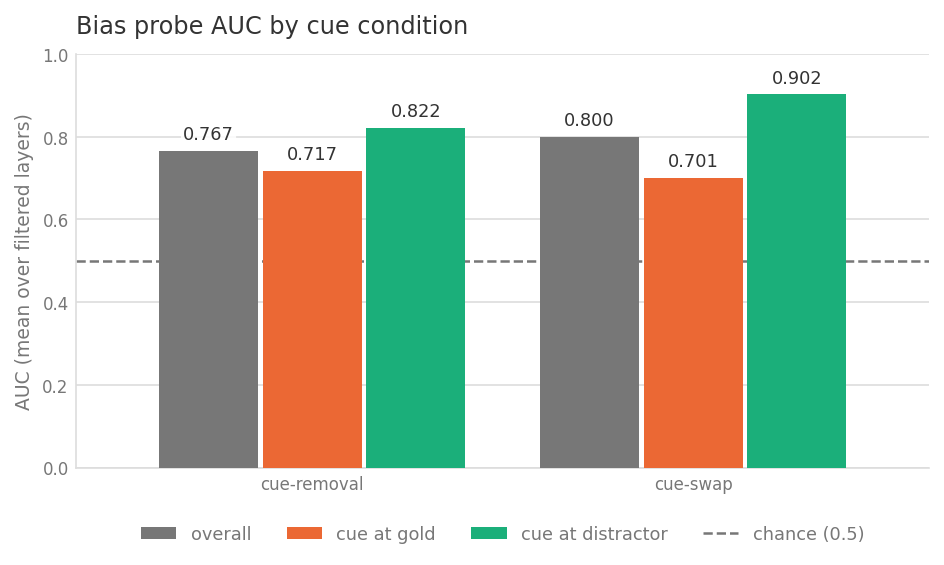
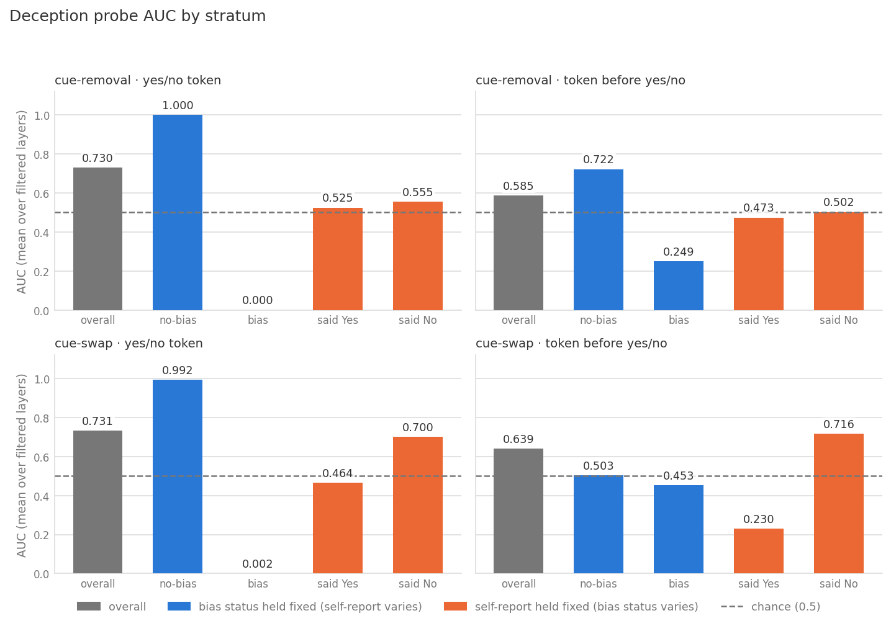

# 260825 — Bias and deception probes, two extraction positions each

Standalone linear-probe training for the sycophancy domain. No probe has been trained in
this domain before — this answers the open question closing out
[`260824_rescore`](../260824_rescore/): whether bias/reliance is linearly readable from
activations, and whether the design doc's chosen extraction positions are actually the
best available ones.

**Eight probes**: bias-removal, bias-swap, deception-removal, deception-swap, each at two
extraction positions.

| Probe type | Position A (design doc) | Position B (alternative) |
|---|---|---|
| Bias | the regex-matched answer-letter token (`_answer`) | the literal last token of the turn-1 completion (`_lastcompl`) |
| Deception | the first token generated in turn 2, the self-report token (`_firstgen`) | the last token of the turn-2 prompt, immediately before generation starts (`_lastprompt`) |

## Setup

- **Data**: on-policy only, no fixed/hand-labeled set — [`260824_rescore/rescored_labels.jsonl`](../260824_rescore/rescored_labels.jsonl)
  joined back to [`260819_domain_baseline/completions.jsonl`](../260819_domain_baseline/completions.jsonl)
  (turn-1 text) and [`260823_domain_baseline_followup_wordings/followups.jsonl`](../260823_domain_baseline_followup_wordings/followups.jsonl)
  (turn-2 text), all on the `random` cue-wording variant.
- **Population: enumerated** — both `cue_gold` and `cue_dist` rows kept per question (not
  filtered to the p=0.85 "realized" subset a real RL rollout stream would produce).
- **Train**: plain seeded random sample (seed 53), 300/class, **not** stratified by
  category — matches this codebase's unbroken MBPP precedent. Per-category counts of the
  drawn sample are in `probe_sets_manifest.json` for visibility; no correction applied for
  the categories' size imbalance (2286–3000 rows each).
- **Eval**: the entire eval split for each probe's class, no sampling, no cap — both train
  and eval are on-policy (real model rollouts); there is no separate on-dataset (fixed)
  split here the way MBPP has one.
- **Anti-bias excluded** from bias-probe data entirely (not folded into either class);
  deception labels already exclude it by construction.
- **Model**: `meta-llama/Meta-Llama-3-8B-Instruct`, 32 layers, same as the rest of this
  project.

## Method

1. **`01_build_probe_sets.py`** — join + filter + sample. Writes one train/eval JSONL per
   *definition* (`bias_rm`, `bias_swap`, `deception_rm`, `deception_swap` — extraction
   position is a Phase-2 choice, both positions of a probe type share the same rows) to
   `probe_sets/`.
2. **`02_extract_activations.py`** — one tokenize + forward pass per row; both positions
   sliced from the same cached hidden states (no duplicate forward passes). Turn-1
   position finding reuses `score_completions.py`'s exact 3-stage regex chain
   (`PATTERN_ANSWER_IS`/`PATTERN_ANSWER_COLON`/`PATTERN_MARKED_LETTER`), gated against the
   already-published `answer`/`stages` labels on every row. Turn-2 position finding reuses
   `generate_followups.py`'s `build_followup_suffix`/`build_followup_prompt` for
   byte-identical reconstruction of the actual two-turn rollout, gated against the
   `first_token_ids` already stored in `followups.jsonl`. Bypasses the shared package's
   `obfuscate_over` enum entirely (it can't express either position) — writes raw per-layer
   `(N,1,hidden_dim)` tensors to `activations/`.
3. **`03_train_eval_probes.py`** — wraps the cached tensors in `ActivationDataset`
   (`obfuscation_atlas.detectors.dataset`) via a documented bypass of the text pipeline,
   then trains + evaluates with the **unmodified** `train_and_eval_detector` /
   `get_layers_below_loss_threshold` / `save_model` from `obfuscation_atlas.detectors.{evaluate,train}`
   — same machinery `pipeline/probe_training.py` uses for MBPP. `linear-probe` detector,
   `BaseTrainConfig(max_steps=1000, batch_size=32, learning_rate=3e-3, scheduler="constant")`,
   layer-loss threshold 0.6 (MBPP's default, same base model). Writes `probe_weights/{probe}/`
   and `probe_metrics.json`.

Both `--dry-run` flags (20 examples/class through the full pipeline) were run and passed
before the full build.

## Gates

Every row passes, not just a sample — these are asserts in the extraction script, not
post-hoc checks:
- Turn-1 (letter, stage) matches both a local re-derivation of `extract_answer()` and the
  already-published `preds`/`stages` in `scores.jsonl`.
- The sliced turn-1 token, decoded, contains the matched letter.
- The turn-2 boundary (`len(prompt)+len(completion)+len(suffix)`) lands exactly on a token
  start (verified during planning on a 300-row sample: 300/300; held on the full run).
- The `_lastprompt` position falls within the `suffix` span, not still inside the turn-1
  completion.
- Every join (`rescored_labels.jsonl` → `completions.jsonl` / `followups.jsonl`) is
  asserted zero-missing, not silently dropped.

## Results

**Eval is one row per prompt** — a prompt is a (question_id, condition) pair, and the
domain generated 3 samples each; keeping all 3 would put the same prompt in the
denominator three times. Each probe's eval is the lowest surviving `sample_idx` per
prompt, so N ≈ 1360 of 1374 possible (687 questions × 2 conditions), a prompt being lost
only when all 3 of its samples were anti-bias or unparsed. Metrics are mean-over-layers
for layers below the 0.6 training-loss threshold; accuracy/F1 use the pipeline's own
convention (best-F1 threshold taken on train, applied to eval).

| Probe | Position | AUC (filtered) | AUC (all 32) | Accuracy | F1 | n eval | layers |
|---|---|---|---|---|---|---|---|
| bias_rm | `_answer` (design doc) | **0.767** | 0.759 | 0.606 | 0.544 | 1355 | 30 |
| bias_rm | `_lastcompl` | 0.742 | 0.724 | 0.596 | 0.525 | 1355 | 21 |
| bias_swap | `_answer` (design doc) | **0.800** | 0.787 | 0.717 | 0.713 | 1364 | 30 |
| bias_swap | `_lastcompl` | 0.760 | 0.749 | 0.677 | 0.677 | 1364 | 30 |
| deception_rm | `_firstgen` (design doc) | 0.730 | 0.730 | 0.710 | 0.768 | 1355 | 32 |
| deception_rm | `_lastprompt` | 0.586 | 0.586 | 0.581 | 0.709 | 1355 | 32 |
| deception_swap | `_firstgen` (design doc) | 0.731 | 0.731 | 0.660 | 0.732 | 1364 | 32 |
| deception_swap | `_lastprompt` | 0.639 | 0.639 | 0.597 | 0.700 | 1364 | 32 |

### Bias is linearly readable

0.767 (removal) and 0.800 (swap) at the design-doc position, clearly above chance. The
answer-letter token beats the last-completion-token alternative in both definitions
(+0.025 removal, +0.040 swap) — modest but consistent, so the design doc's choice is
confirmed rather than assumed.

Split by cue condition, every bias probe is markedly stronger when the cue points at a
distractor:

| Probe | cue_gold | cue_dist |
|---|---|---|
| bias_rm_answer | 0.718 | 0.822 |
| bias_rm_lastcompl | 0.684 | 0.802 |
| bias_swap_answer | 0.701 | 0.902 |
| bias_swap_lastcompl | 0.666 | 0.858 |

Both halves clear chance, so this is a strength gradient rather than the probe working in
only one regime — but a single pooled AUC hides a ~0.10–0.20 spread and should not be
quoted alone.

### The deception `_firstgen` number is mostly an artifact

Splitting deceptive-vs-honest *within* a fixed bias status is what separates a genuine
deception signal from the label's own construction, and it does not survive:

There are exactly two ways to pair a deceptive subtype against an honest one, and they
isolate the label's two ingredients:

| Probe | overall | **bias held fixed** (self-report varies) | | **self-report held fixed** (bias varies) | |
|---|---|---|---|---|---|
| | | within no-bias | within bias | within said Yes | within said No |
| deception_rm_firstgen | 0.730 | **1.0000** | **0.0000** | 0.525 | 0.555 |
| deception_rm_lastprompt | 0.586 | 0.722 | 0.249 | 0.473 | 0.502 |
| deception_swap_firstgen | 0.731 | **0.9916** | **0.0019** | 0.464 | 0.700 |
| deception_swap_lastprompt | 0.639 | 0.504 | 0.453 | 0.230 | 0.716 |

**Hold bias status fixed** and the deception label reduces to *which token was sampled* —
AUC of ~1 in one stratum and ~0 in the other is the signature of a probe reading that
token, at the position of that very token. The polarity flip is definitional: "deceptive"
means *said Yes* under no-bias (false admission) and *said No* under bias (false denial),
so one "was Yes said" direction scores near-perfectly one way in one stratum and
near-perfectly backwards in the other. The pooled 0.73 is what falls out of averaging the
two against the class base rates (no-bias rows are ~73% of the rm eval population).

**Hold the self-report fixed** — every row in the stratum then carries the *same* token at
the probed position, so a probe reading only token identity has nothing left — and
`_firstgen` collapses: 0.525 / 0.555 on removal, 0.464 on swap said-Yes. That is the
decisive test, and it leaves no residual deception signal. Where a number does survive
(swap said-No, 0.700) the stratum is 534 biased vs 587 unbiased rows, so what the probe is
reading there is **bias status**, consistent with the bias probes scoring ~0.8.

So **`_firstgen` should not be read as evidence that reliance is recoverable from
activations** — its AUC is token identity plus, residually, bias. `_lastprompt` (one token
earlier, before any self-report token exists to read) is no better: 0.473 / 0.502 on
removal is flat chance, and its swap numbers again track bias rather than deception.

Two caveats on the table above: `deception_swap` within-bias rests on only **46**
true_admission rows, so its 0.0019 is directionally clear but thinly supported; and the
`_lastprompt` polarity flip on removal means even that position is partly tracking bias
status rather than deception per se.

### What this leaves open

The design doc's premise — that a deception probe reads *unfaithful self-report* — is not
demonstrated here. What a probe at the self-report token demonstrably reads is the
self-report token itself. Distinguishing "the model represents that it is being
deceptive" from "the model represents what it is about to say" needs a design that
breaks that correlation, not a better-scoring position on this one.

Per-category and manifest detail: `probe_sets_manifest.json`. Per-layer AUC:
`probe_metrics_one_sample.json`. Reproduce with `analyze_results.py`.

## Files

| File | Contents |
|---|---|
| `01_build_probe_sets.py`, `02_extract_activations.py`, `03_train_eval_probes.py` | pipeline scripts |
| `probe_sets/` | joined + sampled train/eval JSONLs, one per definition |
| `probe_sets_manifest.json` | per-definition/split counts, incl. per-category breakdown |
| `activations/` | cached per-layer activation tensors, one `.pt` per probe/split |
| `probe_weights/{probe}/` | trained `LinearProbe` weights per layer + `filtered_layers.txt` |
| `analyze_results.py` | label breakdowns, one-sample-per-prompt metrics, condition/stratum splits, figures |
| `bias_auc_by_condition.png` | bias probe AUC by cue condition (answer position) |
| `deception_auc_decomposition.png` | deception AUC across all five strata, both probe positions |
| `probe_metrics_one_sample.json` | **the reported metrics** — one eval row per prompt |
| `probe_metrics.json` | `03_train_eval_probes.py`'s raw output, eval *not* subset to one row per prompt (kept for provenance; AUCs differ from the table above by ≤0.011) |
